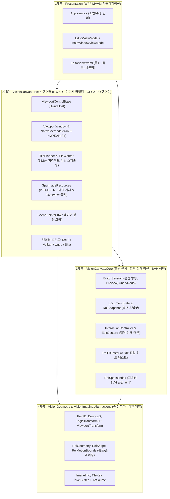
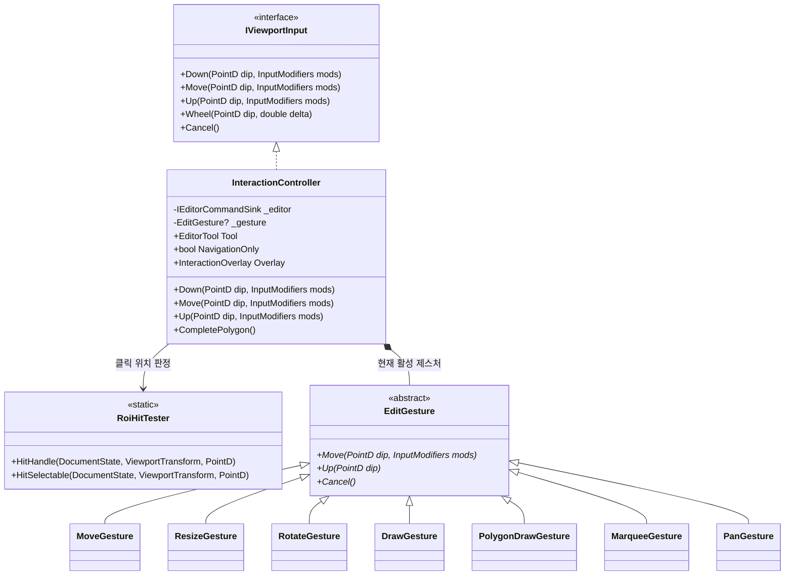
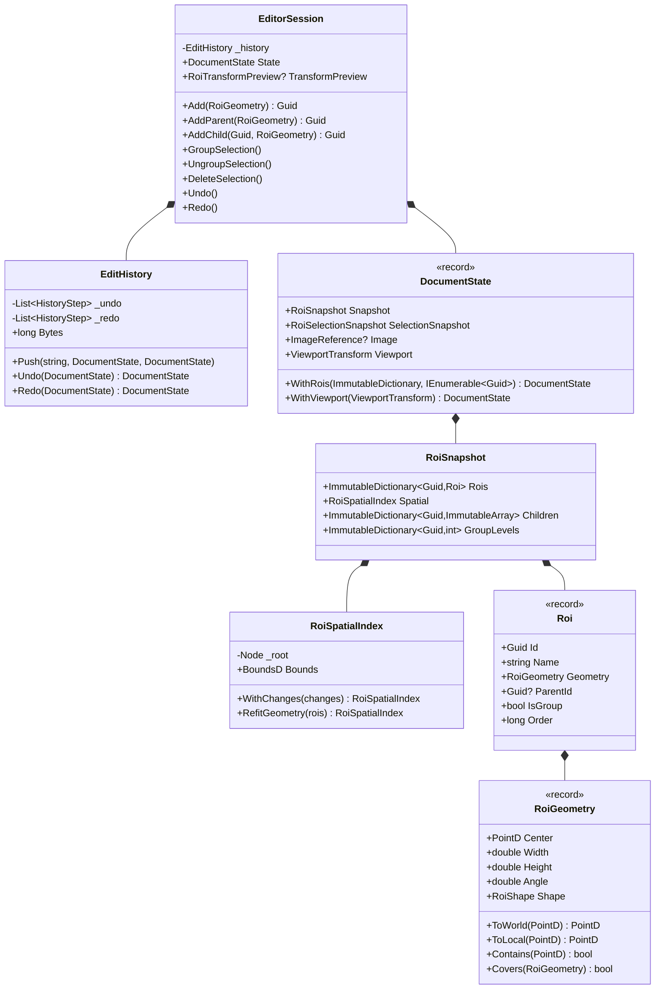
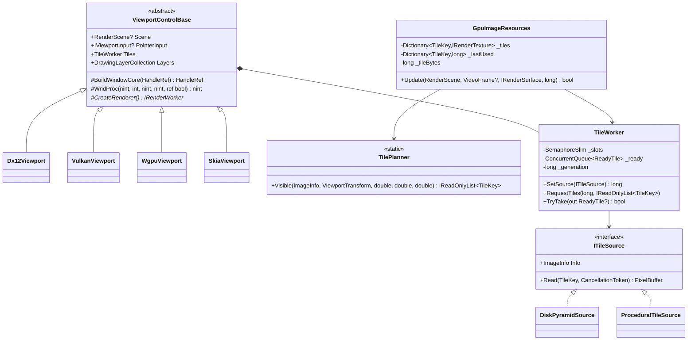

# VisionCanvas 전체 구조 · 클래스 다이어그램 · 이미지 타일링 아키텍처 (ARCHITECTURE)

이 문서는 `VisionCanvas`가 왜 지금과 같은 **4계층 단방향 구조**와 **3스레드 분리 모델**로 설계되었는지, 그리고 **전체 UML 클래스 다이어그램**과 **8K~32K 대용량 이미지 타일링(Image Tiling & Pyramid Streaming)** 원리를 고등학생도 이해할 수 있는 비유와 다이어그램으로 설명합니다.

---

## 1. 한눈에 보는 4계층 아키텍처 (Top-Down 조감도)

일반적인 WPF 프로그램에서 이미지 위에 사각형 10개를 그릴 때는 `<Canvas>` 컨트롤에 `<Rectangle>`을 올리면 충분합니다. 하지만 산업용 비전 검사 장비에서는 다음과 같은 극한 조건을 동시에 만족해야 합니다:

- **초고해상도 이미지 타일링**: $8{,}192 \times 8{,}192$ (8K) ~ $30{,}720 \times 17{,}280$ (5억 픽셀, `ken32.png`) 이미지를 $512 \times 512$ 타일 피라미드로 쪼개어 메모리 폭발 없이 부드럽게 확대·축소·이동해야 합니다.
- **초대량 ROI**: 수만 개에서 최대 **1억 개($10{,}001 \times 10{,}001 = 100{,}020{,}001$개)**의 검사 영역(ROI)을 추가하고, 선택·이동·회전·복사·붙여넣기·Undo/Redo 할 수 있어야 합니다.
- **멀티 렌더러 호환성**: 동일한 편집 규칙과 수학 공식을 유지한 채 그래픽 백엔드만 **Direct3D 12**, **Vulkan**, **WebGPU(wgpu)**, **Skia(CPU)**로 갈아끼울 수 있어야 합니다.

---

## 2. 서브시스템별 상세 UML 클래스 다이어그램 (Class Diagrams)

### 2.1 입력 & 제스처 상태 머신 클래스 다이어그램 (`VisionCanvas.Core.Interaction`)

### 2.2 불변 문서 · 기하 · 이력 클래스 다이어그램 (`VisionCanvas.Core.Editing` & `VisionGeometry`)

### 2.3 이미지 타일링 & 멀티 렌더러 클래스 다이어그램 (`VisionImaging` & `VisionCanvas.Host`)

---

## 3. 대용량 이미지 타일링(Image Tiling & Pyramid Streaming) 4단계 메커니즘

1. **다단계 피라미드(`ImageInfo.CalculateLevelCount`)**:
   - 원본 이미지를 Level 0으로 두고, 가로·세로를 $\lfloor (W + 1) / 2 \rfloor$씩 반으로 줄여 가장 긴 변이 `512px` 이하가 될 때까지 피라미드 층을 구성합니다.
   - 전체 피라미드 용량은 등비급수 $1 + \frac{1}{4} + \frac{1}{16} + \cdots \approx 1.333\text{배}$에 불과합니다.
2. **가시 타일 계산(`TilePlanner.Visible`)**:
   - 현재 뷰포트 배율과 DPI에서 $\text{level} = \text{Clamp}(\lfloor \log_2(1 / (\text{Scale} \cdot \text{dpi})) \rfloor, 0, \text{Levels} - 1)$을 구합니다.
   - 해당 레벨의 타일 1장이 덮는 원본 픽셀 폭 $\text{tileSpan} = 512 \times 2^{\text{level}}$로 화면 좌상단~우하단을 나누어 가시 행·열 범위만 추출합니다.
3. **백그라운드 디코딩과 세대 관리(`TileWorker` & `PixelBuffer`)**:
   - `PixelBuffer`는 `ArrayPool<byte>.Shared.Rent`로 배열을 대여해 GC 압박을 없애고, `Dispose()`에서 `Interlocked.Exchange`로 반납합니다.
   - `TileWorker`는 `SemaphoreSlim(32, 32)`로 준비된 타일 큐를 최대 32개로 제한하고, 이미지 교체 시 `Generation` 번호를 올려 구형 이미지의 타일을 자동 폐기합니다.
4. **Overview 폴백과 256MiB LRU 퇴출(`GpuImageResources` & `ScenePainter`)**:
   - 피라미드 최상단 타일 `(Levels - 1, 0, 0)`을 항상 보유하여 고해상도 타일이 아직 읽히는 중에도 검은 빈칸 없이 저해상도 전체 배경(`overview`)을 먼저 깔아줍니다.
   - GPU 타일 캐시가 `256 MiB`를 초과하면 현재 프레임에 안 보이는 타일들을 마지막 사용 프레임(`_lastUsed`) 오름차순(LRU)으로 정렬해 퇴출(`Retire`)합니다.
