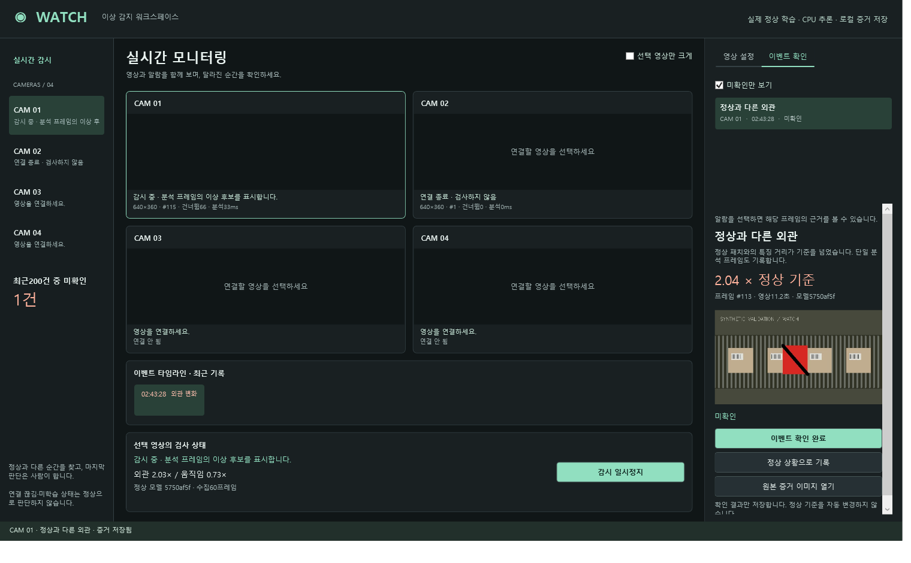
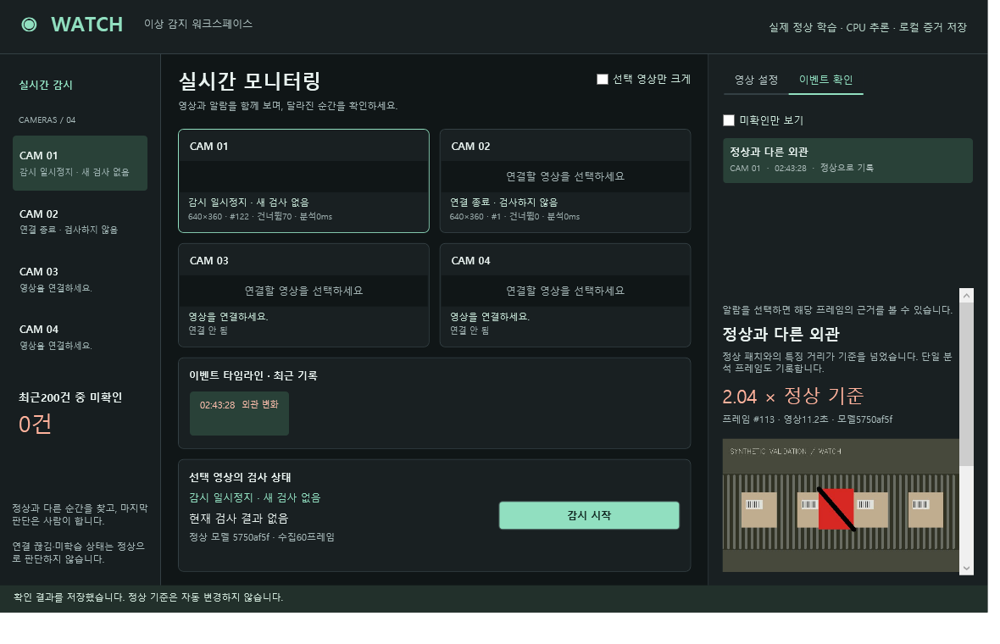

# 독립 영상 이상 감지 구현·검증

2026-10-16, 현재 `main`에서 로컬 수정·검증. 사용자는 실제 영상 입력·정상 학습·이상 감지까지 승인했고 이번 작업의 커밋·푸시는 하지 않는다. [사용법](../src/AnomalyMonitor/README.md), [구조 결정](decisions/0058-independent-anomaly-monitor.md), [측정 JSON](anomaly-monitor/verification.json).

## 검증 결과

| 항목 | 결과와 범위 |
|---|---|
| ONNX 변환 | PASS. PyTorch2.14.1+cpu 대비 최대 절대오차9.5367431640625e-7. C# ONNX golden 대조 테스트 통과 |
| 엔진 회귀 | PASS10. 실제 특징·정상 메모리 학습, 모델 저장/읽기와 hash 거부, 입력 오류/재연결, 수집 취소, 알람 시간·재무장·배율, 기록 경로 검증 |
| 실제 파일 입력 | PASS. 자체 생성 MJPEG AVI640×360,10FPS,240프레임 전부 디코딩 및 파일 끝 구별 |
| 순차 검사 | PASS. 정상 영상80프레임 학습 후 별도 검사 영상80프레임 분석. 11.1초 외관,16.8초 움직임 이벤트. 앞선0~11초 정상 구간 알람0건 |
| 실제 WPF 작업 | PASS. 정상 영상60프레임 수집·모델 저장, 새 검사 영상 연결 시 모델 해제, 명시적 불러오기·감시·알람 JPEG/JSON·검토 결과 저장. 검토가 정상 모델을 바꾸지 않음 |
| 입력/표시 수명 | PASS.2카메라 소스/모델 분리, 일시정지 후 알람 증가 없음, 종료 후 viewport handle0 |
| 화면 | PASS.1520×940과1180×760 창 크기. 바인딩 경고/오류0. 작은 창의 카메라 상태 clipping 수정 후 위치 단언·캡처 확인.1/4화면 전환 |
| 독립 컨트롤 | PASS.7680×4320 BGRA 프레임+원본 좌표 표시를 WARP로 native 캡처하고 픽셀 확인.8K 동영상 처리 성능 검증은 아님 |
| 실제 장치/현장 정확도 | NOT_RUN. USB/RTSP 주소와 현장 정답 영상 미제공.4채널8K 처리·60FPS·다른PC·장시간 운전은 미검증 |

WPF 테스트2개가 각각 실제 시나리오와8K 표시를 검증한다. 엔진10개와 합계12개 PASS/skip0이다. 기존 티칭 앱과 공유 라이브러리는 수정하지 않았고, 기존 전체 회귀1318개를 이번에 재실행한 것으로 표현하지 않는다. 신규 솔루션의 빌드와 변경 C# 파일의 `dotnet format --verify-no-changes --severity warn`을 확인했다.

검토 중 발견한 UI 리소스 범위, 읽기 전용 Run 바인딩, 정상 수집 수 표시, 영상 갱신 중 편집 숫자 덮어쓰기, 숫자 오류 안내가 다음 프레임에 사라지는 문제를 수정했다. 마지막 작은 창 검증에서는 컨트롤 최소 높이로 상태 줄이 잘리는 문제와 타임라인 제목 clipping을 수정했다. 알람 비교 조건을 의도적으로 뒤집자 알람 테스트3개가 실패했고 원본을 복원한 후 전체 관련 검증이 통과했다.

## 시간 측정 해석

별도 순차 분석80회 평균 **27.862ms**, 최대 **32.654ms**였다. 입력은640×360이며 전체 영역을224×224로 분석했다. crop/특징 추론/최근접 거리/flow를 포함하고 영상 디코딩·대기열·UI·200ms 대기는 제외한다. 실제 앱 영상 FPS나 알람 종단 지연으로 사용하면 안 된다.

UI 시나리오는 첫 감지 시각11.2초였다. 샘플링 시점이 실행마다 달라지므로 순차 검사11.1초와 동일 프레임을 보장하지 않는다. 검사와 UI는 가장 최신 분석 프레임을 사용하며 건너뛴 프레임 수를 표시한다. 하나의 비정상 제품이 들어와도 검사 프레임에 포함되면 외관 이벤트가 가능하지만, 검사 사이에 지나가면 놓칠 수 있다.

WPF 화면의 실제 표시 장치는 **NVIDIA GeForce RTX3060 Laptop GPU**, VRAM5.9GiB/당시 budget5.1GiB로 보고되었다. CPU는 사용자 기준 Ryzen5 5600H, RAM32GB 장비다. 추론은 CPU ONNX이며 CUDA 추론을 구현했다고 표현하지 않는다. WARP는 별도 테스트에서 명시적으로 강제했다.

## 화면 증거

아래 WPF 레이아웃 캡처에는 네이티브 HWND인 DX12 영상 면이 포함되지 않는다. 검은 영상 영역은 `RenderTargetBitmap`의 캡처 한계다. 실제 영상·ROI 캡처는 마지막 native 이미지로 별도 보존했다. 두 이미지를 합성해 실제 스크린샷이라고 표현하지 않는다.






## 재현과 기록

```powershell
dotnet build AnomalyMonitor.slnx -c Release
dotnet test tests/VisionAnomaly.Tests -c Release
dotnet test tests/AnomalyMonitor.Tests -c Release
```

테스트를 순서대로 실행한다. 엔진 검증은 샘플 영상을 재생성하므로 UI 검증/재생과 동시에 실행하지 않는다. 원시 TRX는 `artifacts/anomaly-monitor/test-results`, 시계열 점수는 `artifacts/anomaly-monitor/sequence.json`, UI 프레임/모델/이벤트는 `artifacts/anomaly-monitor/wpf`에 있다. 이 문서 옆 JSON과 PNG는 최종 검증에서 복사한 축약 증거다.

## 설계 원칙 검토

기존 Canvas의 프레임·렌더·WARP 기능을 재사용했다. 알고리즘/소스는 WPF를 참조하지 않으며 재사용 컨트롤은 앱/알고리즘을 참조하지 않는다. VM은 상태와 명령, View는 표시/선택 탭, App과 연결 서비스는 구체 수명/구성을 담당한다. 새 기능 이외의 기존 코드 정리나 아키텍처 교체는 하지 않았다.

정상 데이터 오염·조명/카메라 이동·축소로 인한 미세 결함 누락·장면별 임계값 부적합은 남아 있다. 현재 방식은 PatchCore 착안 외관 거리와 flow 통계이며 보편적 CCTV 행동 이해 모델이 아니다. 파일/스트림의 codec·드라이버 지원, USB native read의 종료 지연, 디스크 증거 축적과 장시간 메모리 사용은 실기 검증 대상이다. 분석224×224와8K 표시를 혼동하지 않는다.
