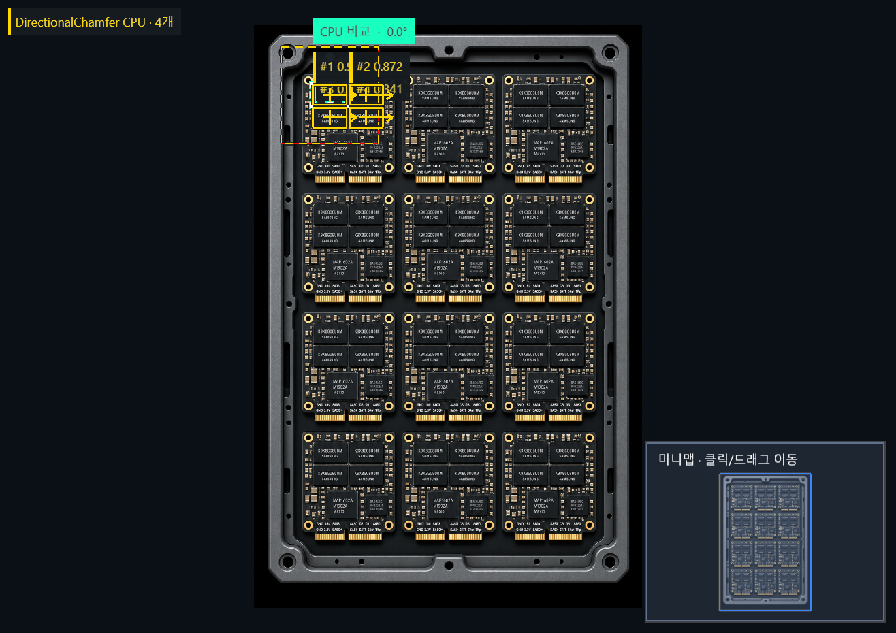
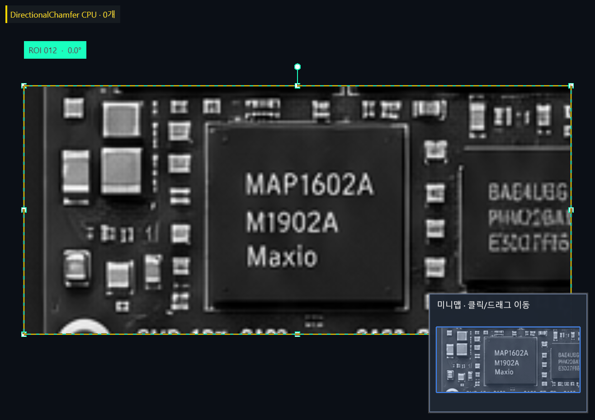

# CPU 매칭 정확도 보정과 재사용 최적화

2026-10-16. 사용자 우선순위를 **정확한 검출 → 속도 개선**으로 반영했다. WPF에 연결한 Line2D/Sub-NCC/Directional Chamfer 중 확인된 Chamfer 오검출 원인을 수정했다. 로컬 수정·검증만 진행했으며 기존 PoseMatch 경로는 유지했다. [ADR-056](decisions/0056-cpu-matching-accuracy-first.md), [WPF 사용법](cpu-matching-wpf.md).

## 수정 원인과 범위

이전 Chamfer는 템플릿 윤곽이 영상에서 가까운지만 평가했다. 조밀한 무관 윤곽도 이 조건을 만족할 수 있었고, 실제 대상이 없는 체크무늬가 약0.8517점을 얻었다. 또한 원본 거리 단위가 템플릿 크기에 따라 최대3px까지 늘어나 다른 크기/형태의 칩도 관대하게 평가했다.

최종 원본 pose에서 **template→scene와 scene→template의 방향 거리 지지율을 함께 평가**한다. 역변환한 템플릿 내부만 평가하고 crop 미분 경계2px는 제외한다. 역방향은 영상 gradient 크기로 가중하고 두 방향을 조화평균으로 결합한다. 원본 거리 단위는0.6~1px로 제한하며 coarse의5px 허용은 유지했다. 양방향 검증만 추가했을 때 남았던 음성 영역 오검출1개도 원본 거리 보정 후 사라졌다.

**최소 점수0.75, 검색 범위·각도·배율·후보 예산·NMS를 그대로 유지했다.** Kensa별 분기나 정답 위치 주입을 넣지 않았다. 기존 기하 방식이나 NCC를 혼합하지 않았으며, Chamfer 점수의 의미가 변경되었으므로 이전 버전과 같은 수치를 직접 품질 차이로 읽으면 안 된다. 임의 가림/인쇄 차이에 대한 일반적인 강건성은 추가 검증이 필요하다.

## 정확도 결과

평가 기준은 **누락0·오검출0, 위치1px·각도1°·배율0.03 이내, 후보/출력 잘림 없음**이다. 결과 개수만으로 합격시키지 않는다.

|검증|Line2D|Sub-NCC|Directional Chamfer|
|---|---|---|---|
|Kensa 부품4개 제한 영역|4/4|4/4|수정 전8개 → 수정 후4/4|
|Kensa 다른 부품 음성 영역|0개|0개|수정 전4개 → 수정 후0개|
|기존 완전 정답 합성15장|15/15 통과|15/15 통과|15/15 통과|
|기존 원본18V 알려진 대상|통과|통과|통과|
|수정 후 추가 합성3장|3/3 통과|3/3 통과|3/3 통과|

총21장면 중 완전 정답20장면(합성18+Kensa 제한 영역2)에서 세 방식 모두 통과했다. 나머지 원본18V는 알려진 한 대상만 확인했다. Kensa 네 부품 중심은 첫 학습 crop 외에는 약±1px의 수작업 정답이다. 해당 표의 PASS는 **현장 전수 검출률·제품 OK/NG·서로 다른 모든 부품 구분 보장**이 아니다.

추가3장은 수정 후 생성한 Kensa crop의 흐림/밝기/잡음·회전/배율 장면이다. 이 결과를 보고 상수나 임계값을 다시 조정하지 않았다. 위치 최대0.14px, 각도 최대0.33°였다. 기존15장에서는 위치 최대0.35px, 각도 최대1°였다. 같은 원본 템플릿의 합성이므로 독립 현장 촬영으로 볼 수 없다.

8K 시험은 실제8192×8192 PNG 안의 **512×512 검색 영역**에서 두 대상을 찾는 시험이다. 세 방식 모두 누락/오검출 없이 원본 위치·각도를 확인했다. 라이브러리의2Mpx 검색 예산은 유지되며 **8K 전체 탐색은 아직 지원/검증 완료가 아니다.**

- [수정 전 Kensa 원시 결과](cpu-accuracy-before.json), [수정 후](cpu-accuracy-after.json)
- [기존16장 회귀](cpu-accuracy-regression.json), [추가3장 검증](cpu-accuracy-validation.json)
- [Kensa 데이터·정답](../samples/CpuMatching.Accuracy/README.md), [추가 데이터·정답](../samples/CpuMatching.AccuracyValidation/README.md)
- [전체 테스트 데이터·보고서 ZIP](data/cpu-accuracy-comparison.zip)

## WPF 확인

실제 WPF 방식 선택 바인딩·학습/검사 명령·원본 reader·결과 게시·DX12 표시 경로로6조건×3방식×3회, **54회 모두 정확도 조건과 표시 확인을 통과**했다. 18V 원본, 부품 원본, 다른 부품 음성, Kensa crop 회전2장, 별도179° 합성 형상이다. 원본 부품은 개수4와 알려진 학습 대상의 pose를 확인했고 나머지 세 부품의 정밀 좌표는 별도 CLI의 수작업 정답과 비교했다.

[WPF 원시 JSON](cpu-accuracy-wpf.json), [전체 요약 CSV](cpu-accuracy-wpf-summary.csv). 아래 Chamfer 화면에서 검색 영역의 네 부품과 음성 영역0개를 확인했다. 노란 결과는 기존 정책대로 사용자 확인이며 제품 합격 표시가 아니다.





## 성능 개선과 남은 지연

원본 전체 crop의 복사를 생략하고 coarse 응답 버퍼를 재사용했다. 같은 검사/피라미드 레벨의 정확히 같은 각도·배율 계산을 제한된 캐시에 보관한다. 캐시 용량은 템플릿 크기에 따라1~128개이며 초과 시 그대로 계산한다. 임계값·해상도·후보 평가 횟수를 줄이지 않았고 영상 준비를 클릭 이전으로 옮기지 않았다.

정확도 보정 후의 버전을 기준으로 최적화 전후를 비교했다. Kensa2장×3방식 및 기존16장×3방식의 **검출 순서·좌표·각도·배율·점수와 평가 횟수가 모두 정확히 동일**했다. [전후 동일성·할당 요약](cpu-accuracy-performance.json), [최적화 전 원시 결과](cpu-accuracy-before-optimization.json), [후 원시 결과](cpu-accuracy-after.json).

Ryzen5 5600H / Windows x64 / .NET10.0.13 Release, CPU 단일 순차 Find. 반복5회 중앙값이며 JIT가 포함된 최초 값도 원시 보고서에 보존한다. Find는 crop/피라미드/특징/검색/정밀화를 포함하고 PNG 읽기·UI 표시는 제외한다. 할당량은 동기 Find의 `GC.GetAllocatedBytesForCurrentThread` 차이로, 프로세스 메모리 상한이나 peak가 아니다.

|Kensa4개 영역|Find 전→후 ms|관리 할당 전→후 MiB|
|---|---:|---:|
|Line2D|130.1 → 138.0|40.82 → 35.25|
|Sub-NCC|149.7 → 138.0|27.38 → 12.97|
|Chamfer|240.4 → 226.5|33.27 → 30.43|

Sub-NCC의 할당이 약53% 줄었다. Line2D의 이 측정은 시간이 오히려 늘었으므로 세 방식의 일관된 속도 향상으로 주장하지 않는다. 작은 표본과 실행 중인 사용자 앱/시스템 부하가 있어 속도 순위를 일반화하지 않는다. OpenCV 기본 고정각·샘플 회전 비교도 JSON에 남겼지만, 최적화된 OpenCV 파이프라인 전체보다 빠르거나 정확하다는 증거는 아니다.

추가8K/512×512 영역의 넓은 배율0.75~1.25 검색은 Find 중앙값 Line2D58.2ms / Sub-NCC446.4ms / Chamfer433.2ms였다. 파일 읽기·표시를 제외한 수치이며125ms 달성 근거로 사용하지 않는다.

WPF의 이번 원본 부품 검사 반복2회 평균은 다음과 같다. 별도 offscreen 창에서 측정했으며 실제 물리 클릭 메시지 대기·모니터 scan-out은 포함하지 않는다. 화면은 RTX3060 DX12, 알고리즘은 CPU다.

|방식|검색 ms|서비스 ms|명령→Present fence ms|다음 WPF Rendering 관찰 ms|
|---|---:|---:|---:|---:|
|Line2D|151.0|157.6|726.4|1370.6|
|Sub-NCC|126.6|130.8|1435.8|1965.0|
|Chamfer|248.6|252.9|1379.4|1688.5|

이번 실행은 이전 WPF 기록보다 표시 대기가 커졌다. 검색 비용과 화면 경로 지연을 분리해 기록했으며 offscreen/다른 앱 부하 중 어느 요인이 원인인지는 확정하지 않았다. **검사 버튼부터 표시까지 CPU125ms 목표는 여전히 FAIL**이다. 원본18V의 Sub-NCC도 검색 반복 평균1675.9ms로 큰 비용이 남았다. 다음 속도 작업은 작은 문자 표본 점수 계산과 명령/게시/렌더 큐 대기를 각각 프로파일링해야 한다. CUDA80ms는 이번 CPU3종의 측정 대상이 아니며 기존 목표 미달 상태를 대체하지 않는다.

## 재현·검증 상태

```powershell
dotnet build CpuMatching.slnx -c Release --artifacts-path artifacts/cpu-accuracy -p:RestorePackagesPath=.packages
dotnet test tests/CpuMatching.Tests -c Release --artifacts-path artifacts/cpu-accuracy -p:RestorePackagesPath=.packages
& ./artifacts/cpu-accuracy/bin/CpuMatching.Evaluation/release/CpuMatching.Evaluation.exe run samples/CpuMatching.Accuracy artifacts/cpu-accuracy-local.json all 5
& ./artifacts/cpu-accuracy/bin/CpuMatching.Evaluation/release/CpuMatching.Evaluation.exe run samples/CpuMatching.AccuracyValidation artifacts/cpu-accuracy-validation.json all 3
& ./artifacts/cpu-accuracy/bin/CpuMatching.Evaluation/release/CpuMatching.Evaluation.exe run samples/CpuMatching.Data artifacts/cpu-accuracy-regression.json all 3

dotnet build src/TeachingToolWpf/TeachingToolWpf.csproj -c Release --artifacts-path artifacts/cpu-wpf -p:RestorePackagesPath=.packages -p:CreateHardLinksForCopyFilesToOutputDirectoryIfPossible=true
& ./artifacts/cpu-wpf/bin/TeachingToolWpf/release/TeachingToolWpf.exe --cpu-kensa-comparison
```

- PASS: 신규 체크무늬 오검출 재현은 수정 전 실패, 수정 후 통과. CPU8개+WPF 연동/모드/숫자 입력58개=66개 회귀.
- PASS: 독립 솔루션과 WPF Release 빌드0경고/0오류. WPF54회 종료 코드0.
- PASS: 변경 C#의 좁은 포맷·스타일 검사. 추가 종속성 없음.
- FAIL: 전체 `scripts/Format-Code.ps1 -Verify`는 기존 PoseMatch 벤치마크/VM 등 다른 파일의 공백 위반으로 실패. `artifacts/cpu-accuracy-format-global.log`에 보존하며 무관한 파일을 일괄 수정하지 않았다.
- NOT_RUN: 현장 전수 라벨/다른 촬영·가림 수준별 검증,8K 전체,물리 클릭→scan-out,별도 GPU 없는 저사양 PC.

## 설계 원칙 검토

|원칙|이번 변경의 확인|
|---|---|
|SRP|Chamfer가 원본 점수 계산, PyramidSearch가 탐색/최종 수집, 평가 도구가 정답 비교를 담당|
|OCP|기존 레벨별 점수 전략에 최종 검증을 연결하고 다른 알고리즘 점수는 기본 구현으로 유지|
|LSP|동일 영상·좌표·취소·상한 계약을66개 회귀와 전후 결과 비교로 확인|
|ISP|기존 내부 검색용 IScoreLevel에 기본 검증 한 메서드만 추가, 호출자에 새 구현 강제 없음|
|DIP|CPU 라이브러리는 WPF/OpenCV 의존성이 없고 기존 앱 조립/서비스 경계 유지|
|Information Expert|방향 거리/역변환 점수는 맵·템플릿을 가진 Chamfer, 버퍼 재사용은 검색 소유자|
|Creator|레벨이 거리 맵을 만들고 한 Find가 캐시를 생성·소유하며 실행 간 공유 없음|
|Controller|진단이 기존 VM 명령을 호출하고 View에는 검출 규칙을 넣지 않음|
|Low Coupling|중립 Match/GrayImage 계약 사용, 데이터 생성의 OpenCV는 평가 도구 내부|
|High Cohesion|추가 윤곽 검증은 Chamfer 내부, 공통 탐색에 Kensa/특정 알고리즘 분기 없음|
|Polymorphism|IScoreLevel.Verify 기본/전용 구현으로 최종 점수 변형 처리|
|Pure Fabrication|한 검사 안의 bounded cache만 기술 책임으로 두고 새 전역 관리 서비스 없음|
|Indirection|기존 점수 전략·검사 서비스 경계를 사용, 라이브러리에서 UI 접근 없음|
|Protected Variations|검증 점수 변경을 구현에 한정하며 Canvas/ROI 계층/Undo·Redo 계약 유지|

설계 원칙 예외 없음. 원본 소유권, 취소, 예산 초과 경고와 사용자 파라미터를 보존했다.
