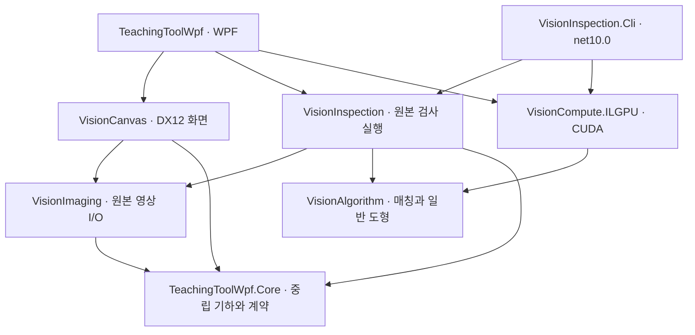

# ADR-023: 플랫폼 독립 검사와 후보 검증 예산

- 일자: 2026-10-04
- 상태: 구현. 실행 증거와 미검증 범위는 [검증 기록](../portable-inspection-validation.md)을 따른다.
- 근거: Windows 전용 화면과 향후 Linux 검사 분리 승인, 검출력이 낮은 빠르게 프리셋의 개선 또는 삭제 요청.

## 후보 검증 순서

40개 반복 합성 패턴에서 기존 빠르게 설정은 6개, 기본 설정도 11개만 검출했다. 후보를 점수 순으로 원본 검증 예산만큼 자르면서 같은 물체에 해당하는 가까운 위치·각도·배율 후보가 예산을 먼저 사용했다. 빠르게는 자세 정밀화도 꺼서 가림 조건의 pose 정확성을 해쳤다.

`VerificationCandidateScheduler`는 예산을 넘긴 경우에만 근접 pose 묶음을 순서대로 한 번씩 방문하고, 남은 예산을 기존 점수 순서로 채운다. 공간 셀과 주변 셀을 조회하며 translation 및 모델 반경을 곱한 회전·배율 차이를 함께 비교한다. 거리 기준은 짧은 모델 변의 5%, 0.5~4px 범위다. 같은 중심의 다른 각도·배율을 무조건 하나로 합치지 않는다. 예산 이내 입력의 순서는 그대로다.

후보를 검증 전에 영구 삭제하는 NMS가 아니다. 최종 점수 계산·필터·정렬·NMS는 기존 순서를 유지한다. 생략 후보가 남으면 불완전 검색 경고를 유지한다. 기본 예산 2048/64, 점수 .72를 바꾸지 않고 같은 입력에서 40개를 검출했다. 임계값을 낮추거나 누락을 숨기는 재시도는 추가하지 않는다.

빠르게 선택지는 제거했다. **기본 후보 예산**(2048/64/256)과 **확대 후보 예산**(8192/256/1024)은 모두 정밀화를 켠다. 과거 enum `Fast=0` 값은 숫자를 바꾸지 않고 기본 예산으로 정규화한다. 사용자가 고급 파라미터를 직접 조절하면 사용자 설정으로 표시한다. 예산 확대가 속도나 전 입력의 검출을 보장하지 않는다.

## 프로젝트 경계

기존 원본 파일·타일 읽기와 CPU 영상 소스는 VisionImaging, 검사 서비스·독립 reader·타일 캐시·피라미드는 VisionInspection으로 옮긴다. namespace는 기존 호출 호환을 위해 유지한다. 알고리즘은 Core/WPF/Canvas/DirectX를 참조하지 않는다. Canvas는 알고리즘·검사 공급자를 참조하지 않는다. 실제 이미지 교체·결과 세대 검사·UI 이력·판정은 앱 책임을 유지한다.

실행 호스트가 OS별 native libvips/OpenCV 패키지를 선택한다. 공통 라이브러리는 Windows native runtime을 강제하지 않는다. 현재 대상은 win-x64/linux-x64다. headless CLI는 동일 서비스로 JSON 레시피를 실행하며 제품 OK/NG 판정 대신 완료·불완전·취소·오류와 검출 데이터를 반환한다. 원본/레시피 덮어쓰기를 거부하고 결과 파일은 원자적으로 교체한다. 모델 파일 영구 저장은 이번 범위에 넣지 않는다.

## CUDA 계산 범위와 정확성

검사용 DX12 구현을 삭제하고 중립 `IImagePreprocessor`와 선택형 `CudaImagePreprocessor`를 사용한다. ILGPU/ILGPU.Algorithms 1.5.3을 고정한다. Gaussian 가로·세로 두 패스와 Sobel dx/dy를 같은 CUDA stream의 연속 계산으로 수행하고 중간 평활화 영상을 CPU로 돌려보내지 않는다. 영상당 8 Mpx 상한과 버퍼 재사용을 지킨다. 렌더러의 장치·queue·texture는 공유하지 않는다.

GPU 정규화까지 시도하면 부동소수점의 1 ULP 차이로 최종 pose/score가 달라졌다. 허용 오차를 넓히지 않고 Sobel 결과 뒤 정규화·방향 binning을 공통 CPU 구현으로 고정했다. NMS·응답맵·후보 검색·점수·정밀화도 CPU다. CUDA 전체 매칭이나 자동 가속으로 표현하지 않는다.

CPU가 기본이다. GPU 모드는 지원되는 NVIDIA CUDA 장치가 필요하고 초기화 실패·연산 오류를 명시적으로 보고한다. CPU로 조용히 전환하지 않는다. OpenCV 템플릿 매칭과 일반 도형은 현재 CPU만 지원한다. 취소는 제출한 native/GPU 작업이 안전하게 끝난 후 게시를 막으며 시간 한도는 강제 해제가 아니다. 실제 backend/adapter/호출 수/픽셀 수/전송 포함 시간을 결과에 남긴다.

## 설계 검토

SOLID 5: SRP(영상 I/O·검사·UI·CUDA·JSON 파일 책임 분리), OCP(중립 전처리 주입), LSP(CPU/GPU 동등성·오류·취소·소유권), ISP(전처리 1개 메서드와 진단), DIP(알고리즘의 플랫폼 무참조·호스트 조립) 확인.

GRASP 9: Information Expert(원본 reader/기하·후보 pose가 계산 소유), Creator(호스트가 서비스·CUDA 생성, 버퍼 소유자가 해제), Controller(RecipeRunner와 앱 실행 조정), Low Coupling(중립 DTO), High Cohesion(영상/검사/장치 분리), Polymorphism(CPU/GPU 계약), Pure Fabrication(후보 스케줄러·원자적 파일 writer), Indirection(조립점 factory), Protected Variations(OS native 패키지와 장치 격리) 확인. 설계 원칙 예외는 없다.
