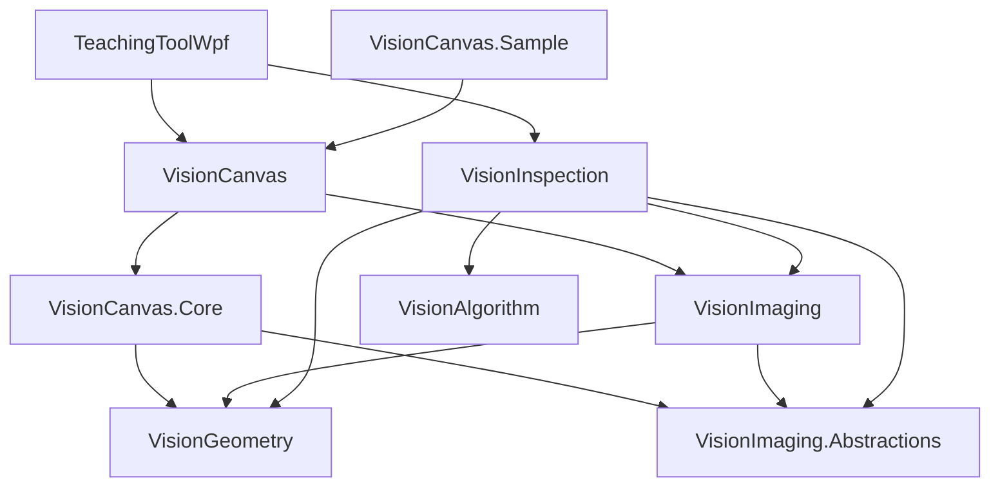

# ADR-031: 재사용 가능한 Canvas와 공통 기하·이미지 계약

- 날짜: 2026-10-05
- 상태: 사용자 요청에 따른 경계 분리 결정. 구현·검증 상태는 [검증 기록](../canvas-reuse-validation.md)을 따른다.
- 범위: `codex/vision-canvas-boundaries`에서 로컬 구현·검증. 커밋·푸시 없음.
- 근거: VisionCanvas를 다른 WPF 앱에 가져다 쓰고, 검사는 이미지와 ROI 정보로 연결하려는 사용자 요청.

## 문제

VisionCanvas는 검사 공급자를 직접 참조하지 않지만, `TeachingToolWpf.Core`에는 공유 기하·이미지 계약과 편집 문서·계층·이력이 함께 있다. VisionImaging과 VisionInspection도 같은 Core를 참조하므로 원본 읽기와 검사만 사용해도 편집 코드가 전이 의존성으로 따라온다. 앱 이름이 공개 namespace에 남아 있는 점도 재사용 경계를 파악하기 어렵게 한다.

기존 Core 의존 자체를 잘못으로 보지는 않는다. Canvas의 ROI 편집은 문서와 입력 상태·이력을 필요로 하고, 기존 불변 스냅샷은 렌더 캐시의 정합성과 성능에 사용된다. 이 관계를 제거하려고 매 프레임 DTO를 새로 만드는 방식은 요구한 재사용성보다 변경·검증 범위를 크게 만든다.

## 결정

1. **`VisionGeometry`:** `PointD`, `BoundsD`, `RoiShape`, `RoiGeometry`, `RigidTransform2D`, `ViewportTransform`, `RotationRange`와 이들이 필요로 하는 순수 기하 계산을 소유한다. 뷰 변환은 수치·좌표 계산이며 WPF 타입을 사용하지 않는다. 편집 문서·선택·WPF·렌더러는 참조하지 않는다.
2. **`VisionImaging.Abstractions`:** `ImageReference`, `ImageInfo`, `PixelKind`, `TileKey`, `PixelBuffer`, `VideoFrame`, `ITileSource`, `IFrameSource` 등 이미지 값과 수명 계약을 소유한다. NetVips나 플랫폼 네이티브 runtime을 참조하지 않는다.
3. **`VisionCanvas.Core`:** 기존 Core의 문서·ROI 엔티티·계층·선택·변형·이력·입력과 편집용 기하 계산을 소유한다. 기하와 이미지 계약만 참조하며 GPU 없이 테스트할 수 있다.
4. **`VisionImaging`:** 원본 I/O와 소스 구현, `TilePlanner`, `LatestFrameMailbox`를 소유하고 편집 코어 참조를 제거한다. 타일 계획에 필요한 기하와 이미지 계약을 참조한다. mailbox는 최신 프레임 보유·전달·해제를 수행하는 영상 실행 유틸리티로 두고 `VideoFrame`의 수명 계약은 Abstractions에 유지한다. 디코더 패키지와 OS별 native 배포 정책은 기존 것을 유지한다.
5. **`VisionInspection`:** 원본 입력과 기하를 사용하고 편집 코어 참조를 제거한다. 레시피·모델과 검사 서비스의 의미·수명·취소 정책을 바꾸지 않는다.
6. **`VisionCanvas`:** 재사용 편집 코어와 영상 계층을 사용하는 WPF/DX12 라이브러리다. 검사·알고리즘·앱에 대한 역참조는 없으며, 호스트에서 제공한 오버레이만 표시한다.
7. **호스트 앱:** TeachingToolWpf는 기존 레시피·제품 판정·모드 상태·표시 adapter와 통합 이력을 유지한다. 독립 샘플은 앱과 검사 참조 없이 같은 공개 API를 조립한다.

그림은 주요 참조 방향이다. 샘플의 직접 프로젝트 참조는 VisionCanvas 하나이며 중립 라이브러리는 전이 참조로 사용한다. 파일 디코더의 OS별 native 패키지는 샘플 호스트가 선택한다. 새 프로젝트는 실제로 여러 소비자가 공유하는 책임을 옮기기 위한 것이며 서비스 로케이터, 범용 플러그인, 새로운 DI 프레임워크는 추가하지 않는다.

## 공개 이름 변경

| 이전 | 이후 |
|---|---|
| TeachingToolWpf.Core.Editing / Interaction | VisionCanvas.Core.Editing / Interaction |
| TeachingToolWpf.Core.Geometry의 순수 좌표·형상·변환 | VisionGeometry |
| 같은 Geometry의 공간 인덱스·편집 경계·핸들·미니맵 | VisionCanvas.Core.Geometry |
| TeachingToolWpf.Core.Imaging의 영상·버퍼 계약, Editing.ImageReference | VisionImaging.Abstractions |
| TilePlanner / LatestFrameMailbox와 공통 원본 I/O | VisionImaging |
| Canvas의 TeachingToolWpf.Controls / Rendering / Presentation / Diagnostics / Imaging | VisionCanvas의 해당 namespace |

검사 서비스와 앱 판정이 공유하던 `TeachingToolWpf.Imaging.Matching` namespace는 이번에 유지한다. assembly 참조는 분리했으며 namespace만 보고 앱 의존으로 판단하지 않는다. 기존 앱 진단용 Canvas friend assembly 지정은 유지하되 독립 샘플은 이를 사용하지 않는다. `PolygonClosure`는 편집 코어에 남기고 외적 계산 한 줄을 로컬 private 메서드로 두어 공통 기하의 내부 타입을 공개하거나 새 friend 의존을 만들지 않는다.

## 데이터와 소유권 경계

검사 입력은 원본 이미지 식별·규격·세대, 독립 reader 또는 보유한 프레임, 원본 좌표의 실제 ROI 형상이다. 작은 사각형 위치만으로 도형 마스크·각도·이미지 버전을 추측하지 않는다. `ITileSource`의 단일 소유 읽기/해제와 `VideoFrame`의 명시적 보유 계약을 유지하고 원본 전체 복사를 추가하지 않는다.

검사 결과의 검출 위치·점수·완료/취소/오류/불완전 상태는 검사와 호스트 사이의 계약이다. 호스트가 입력 세대와 레시피·템플릿·실행 ID를 확인하고 윤곽·색·문구로 변환한다. Canvas에는 검사 실행 객체, 제품 판정, 공급자 타입을 넣지 않는다.

Canvas 편집의 `DocumentState`, ROI 스냅샷, 공간 인덱스와 GPU 리소스 identity를 그대로 유지한다. 타입 소속 변경 때문에 매 프레임 자료를 변환하지 않는다. TeachingToolWpf의 ROI·레시피·이미지 Undo/Redo는 기존 원자적 순서 하나를 사용하며, 독립 샘플에서는 편집 코어의 이력을 직접 사용한다.

## 대안과 영향

- **Core 이름만 변경:** 가장 작지만 검사와 영상 I/O가 편집 코드에 계속 의존해 목적을 만족하지 못한다.
- **공통 이미지 타입을 VisionImaging에 통합:** 프로젝트 수는 줄지만 편집 코어에 NetVips가 전이된다. 구현과 수명 계약을 분리하는 쪽을 선택했다.
- **Canvas에 모든 코드를 합침:** 단일 DLL처럼 보이지만 중립 편집·기하·검사가 WPF/DX12 배포 경계에 묶인다.
- **렌더 전용 DTO/새 입력 인터페이스로 전체 재작성:** 이번 재사용 목표에는 필요하지 않으며 불변 스냅샷·GPU 캐시와 입력/이력 회귀 위험을 늘린다. 기존 공개 조립점을 먼저 사용한다.

프로젝트와 공개 타입 소속 변경은 외부 소비자의 프로젝트 참조·using 갱신과 재빌드가 필요한 소스/바이너리 변경이다. 기존 이름의 대규모 호환 wrapper와 이중 타입은 만들지 않는다. NuGet 배포 자동화, 다른 UI 플랫폼, 새 디코더나 알고리즘은 이번 범위가 아니다.

이 결정은 [ADR-014](0014-canvas-and-explicit-hierarchy.md)와 [ADR-023](0023-portable-inspection-and-candidate-budget.md)의 프로젝트 소속·이름·참조 그래프 부분을 후속 변경한다. 두 ADR의 명시적 ROI 계층, 독립 원본 reader, 플랫폼·CUDA·예산·취소 계약은 유지한다. 기존 검사 성능 목표와 미완료 항목도 그대로다.

## 설계 원칙 검토

| 원칙 | 판단과 확인 경계 |
|---|---|
| SRP | 순수 기하, 이미지 수명 계약, 편집, 디코드, GPU 표시, 검사의 변경 이유를 나눈다. |
| OCP | 기존 타일/프레임 소스와 표시 계약을 유지한다. 새 플랫폼 분기나 불필요한 공급자 인터페이스를 만들지 않는다. |
| LSP | 입력 검증·취소·buffer lease·frame retain 계약을 보존하고 기존 소스/검사 테스트로 회귀를 확인한다. |
| ISP | 이미지 소비자가 편집 API를 참조하지 않는다. 원본 타일·프레임·viewport 계약을 하나의 거대 인터페이스로 합치지 않는다. |
| DIP | 편집 코어는 중립 기하·이미지 계약만 참조한다. WPF/DX12/native 구현은 라이브러리 구현 및 호스트 조립에 둔다. |
| Information Expert | 도형 계산은 기하, 계층·선택과 편집 제약은 편집 코어, 원본 읽기는 소스 소유자가 담당한다. |
| Creator | 문서의 ID/부모 생성 불변식, GPU 생성/해제 주체, frame/pixel buffer 소유자를 바꾸지 않는다. |
| Controller | 입력은 기존 편집 컨트롤러로 전달하고 검사 실행·판정은 호스트/검사 서비스에 남긴다. |
| Low Coupling | Canvas와 검사 간 프로젝트 참조를 두지 않고 호스트가 중립 데이터로 연결한다. 검사는 편집 코어에 전이 의존하지 않는다. |
| High Cohesion | 공유 기하·이미지 계약과 편집 구현을 실제 책임별로 옮긴다. 무관한 공통 유틸리티 프로젝트를 만들지 않는다. |
| Polymorphism | 기존 소스·필터·도형의 실제 변형점을 보존한다. 타입 이동 자체를 위해 새 전략을 추가하지 않는다. |
| Pure Fabrication | 기존 이력·캐시·worker·GPU 수명 서비스는 기술 책임을 유지한다. 소유권을 도메인 값에 몰아넣지 않는다. |
| Indirection | 앱의 typed adapter와 조립점이 알고리즘 입력/결과와 Canvas를 연결한다. 독립 샘플도 공개 API만 사용한다. |
| Protected Variations | 영상 형식·native decoder·WPF/DX12·검사 공급자 변경이 중립 기하와 편집 계약으로 전파되지 않게 참조 그래프를 검증한다. |

모든 항목이 이번 경계 변경과 관련된다. 기존 Command/Memento·State·Strategy/Adapter·Composite·Observer의 역할을 보존하며 패턴을 추가하는 것 자체를 목표로 삼지 않는다. 성능상 설계 원칙 예외는 없다.
