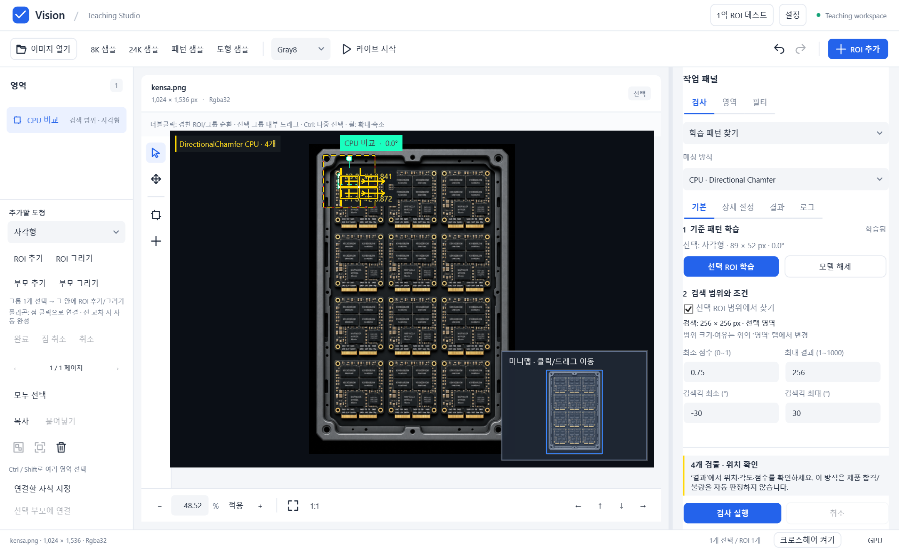
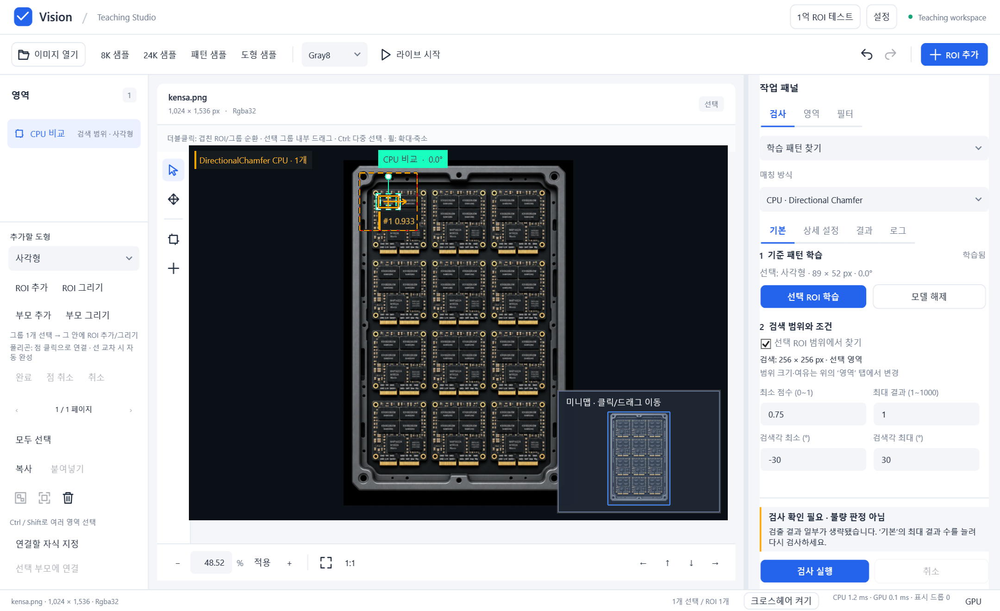

# 오른쪽 검사 패널 사용법과 검증

2026-10-16. 긴 하나의 스크롤을 작업별 탭으로 나눴다. [ADR-057](decisions/0057-inspection-sidebar-workflow.md).

## 사용 순서

1. **검사 → 기본**에서 매칭 방식을 고르고 선택 ROI를 학습한다.
2. 선택 영역에서 찾을지 전체 이미지에서 찾을지 정한다. 실제 검색 크기가 바로 표시된다. ROI 위치·크기·검색 여유는 **영역**에서 바꾼다.
3. 점수·최대 결과 수·CPU 검색 각도를 조절하고 하단 **검사 실행**을 누른다.
4. 검출 좌표·각도·점수는 **결과**, 단계별 시간과 JSON 저장은 **로그**에서 확인한다. OpenCV는 결과 요약의 시간만 제공한다.
5. 배율·정밀 검색·후보 예산 등의 조정은 **상세 설정**을 펼쳐서 한다. ROI 미리보기 필터는 별도 **필터** 탭이다.

패널과 영상 사이의 구분선을 드래그하면 폭을 바꿀 수 있다. 결과 목록과 로그는 자기 영역 안에서 스크롤되고 검사·취소 버튼은 하단에 남는다. 작은 창에서는 기본 내용에도 스크롤이 생길 수 있다.

## 상태 표시

|표시|뜻과 다음 행동|
|---|---|
|학습 대기|이미지에서 ROI 하나를 선택하고 학습|
|다시 학습하세요|학습 조건/마스크가 변경됨. 재학습 필요|
|설정 확인 필요|잘못 입력한 숫자나 범위를 기본/상세 설정에서 수정|
|검사 확인 필요 · 불량 판정 아님|검색이나 출력이 불완전함. 안내에 표시한 후보 예산/결과 수/검색 범위를 조절|
|검출 없음 · 조건 확인|검색 영역·학습 패턴·각도 범위 확인|
|N개 검출 · 위치 확인|제품 자동 OK/NG 판정이 없는 방식의 결과. 결과 탭에서 자세 확인|

경고를 숨기거나 점수·검출 수를 조정한 변경이 아니다. 논문 형상의 기존 정상/회전 NG 정책도 유지한다.

[결과 목록 화면](data/sidebar-results.png).

## 검증

- PASS: 관련 테스트62개(입력 검증, 방식별 상태, CPU 서비스 연동, 판정 정책). 후보 잘림/출력 상한/0개/정상 검출의 Warning·Review 구분과 실행 차단 확인.
- PASS: 실제 WPF 진단 `--sidebar-layout-check` 종료 코드0. Kensa89×52 부품 학습,256×256 검색에서4개와 결과 행4개. 최대 결과1에서는 경고와 설정 안내 유지.
- PASS:6개 방식 × 두 창 크기1440×880/1180×680 DIP. 기본 크기에서는 모든 방식의 기본 탭 스크롤 높이0. Kensa 검사 완료 후에도 기본 입력이 한 화면에 표시됨. 작은 창에서도 하단 검사 버튼이 패널 안에 유지됨. [원시 레이아웃 측정](sidebar-layout.json).
- PASS: 상세 숫자에 잘못된 문자열 입력 → 내부/외부 탭을 왕복하는 동안 검사 차단 → 숫자를 고치면 실행 가능. 기존 편집 가능한 바인딩 이름을 이전 화면과 비교해 누락 없음 확인.
- PASS: 변경 C#의 좁은 스타일/포맷 검사. 캡처는150% DPI의 실제 WPF와 DX12 합성이다.
- FAIL: 전체 포맷 검사는 기존 다른 파일의 공백/줄바꿈 위반으로 실패(`artifacts/sidebar-format-global.log`). 패널 요청에 무관한 파일의 일괄 포맷은 수행하지 않았다.
- NOT_RUN: 최종 대화형 키보드 검증은 사용자의 Esc 입력으로 중단. 다른 DPI/보조기술/장시간 실제 사용성은 미검증. 알고리즘 정확도·125/80ms 성능의 새 합격 근거가 아니다.

2026-10-16 전체 프로젝트 체크포인트 확인: 솔루션 Release 빌드0경고/0오류. 전체 테스트 최초 실행은1314 PASS/4 FAIL이며,4건 모두 이전 경고 문자열을 기대한 `InspectionLimitDecisionTests`였다. 새 문구의 원인과 조치를 각각 검증하도록 갱신한 뒤 해당 WPF 테스트 프로젝트292/292 PASS. 나머지9개 프로젝트1026개 PASS와 합해 **1318개 PASS, skip0**다. 최초 실패 로그는 `artifacts/checkpoint-tests.log`, 최종 WPF 실행은 `artifacts/checkpoint-tests-final.log`다. 원본 외부 라이선스 고지의 후행 공백은 보존하고, 나머지 스테이징 diff 공백 오류는 제거했다. 전체 스타일 검사 미달과 제품 성능·정확도 미달은 이 체크포인트로 해소된 것이 아니다.

## 설계 원칙 검토

|원칙|확인|
|---|---|
|SRP|View의 배치/Validation 수명, VM의 상태/설명, 서비스의 검사 책임 유지|
|OCP|기존 방식별 상태를 표시 속성으로 연결, 알고리즘 수정 없음|
|LSP|검사·취소·잘림·판정 계약을 기존/신규 회귀로 확인|
|ISP|새 공개 서비스 계약을 추가하지 않음|
|DIP|기존 App 주입 유지, VM에서 구체 WPF 컨트롤 접근 없음|
|Information Expert|판정·모델·입력 상태를 가진 VM이 안내 문구 제공|
|Creator|기존 View 생성/서비스 조립 수명 유지|
|Controller|버튼은 기존 명령 바인딩을 사용|
|Low Coupling|Canvas/알고리즘 계약 변경 없음|
|High Cohesion|패널 표시 상태를 부분 파일에 모음|
|Polymorphism|기존 검사 전략과 방식별 실행 경로 보존|
|Pure Fabrication|새 관리 서비스/전역 상태 없음|
|Indirection|기존 바인딩·중립 결과를 통해 표시|
|Protected Variations|UI 탭 전환이 검출 규칙·ROI 이력에 영향 없음|

설계 원칙 예외 없음.
