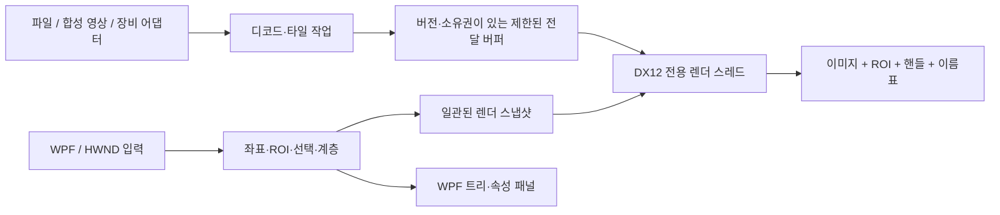

# WPF 비전 티칭 툴 — 구현 계획

- **2026-10-05 폴리곤 입력 수정:** 폴리곤의 부모·자식 추가는 빈 점 입력을 시작한다. 새 선분이 기존 선과 교차하면 진행 방향의 첫 교차점을 꼭짓점으로 삼아 닫힌 영역만 한 번 확정한다. 열린 꼬리/교차 이후 구간은 제외하며 기존 단순 폴리곤·명시적 부모·Undo/Redo 계약을 유지한다. [ADR-028](../docs/decisions/0028-polygon-point-drawing-and-crossing.md).

- **2026-10-04 플랫폼 독립 검사 승인:** [공통 검사·ILGPU·후보 예산 계획](portable-inspection-plan.md)에 따라 검사용 DX12를 제거하고 원본 I/O·검사 실행을 `net10.0` 라이브러리로 분리한다. WPF와 표시 DX12는 유지한다. Linux 실실행과 Windows 검증을 구별한다.

- **2026-10-04 검사 확장:** [작업 계획](inspection-controls-plan.md)과 [ADR-022](../docs/decisions/0022-inspection-scoring-execution-and-primitives.md)에 따라 커스텀 추가 윤곽 점수, 속도/시간/CPU·GPU 실행 제어, 학습 없는 기본 도형 검출을 추가한다. 검증 상태는 작업 목록을 따른다.

- **2026-10-04 논문 형상 후속:** 세 방식의 앱 출력 기본값을 각각256개로 맞추고, 독립 검사 reader 안에서16MiB 원본 Gray8 타일을 재사용한다. 검출 조건과 원본 축소 정책은 유지하며 [ADR-021](../docs/decisions/0021-shape-output-and-original-tile-reuse.md)의 반복 측정/메모리/수명 계약을 따른다.

- **2026-10-04 매칭 방식 분리:** 사용자 앱의 OpenCV 16개 상한에서 결과 생략 무고지 재현과 세 방식별 모델·설정/사용자 파라미터는 [ADR-020](../docs/decisions/0020-matching-modes-and-result-limits.md)을 따른다. 같은 학습 모델로 상한만 올려 256개를 확인했고 수정 후 검증은 todo에 기록한다.

- **2026-10-04 기하 매칭 확장:** PatMax 공개 기능을 참고한 자체 C# 윤곽 품질·검사 기준 확장은 [ADR-019](../docs/decisions/0019-geometric-match-quality.md), 단계와 미구현 범위는 [기하 매칭 계획](geometric-matching-plan.md)을 따른다. 상용 소스 포팅/동등 성능과 구별한다.

- **2026-10-04 검출 윤곽 후속:** 학습 ROI 도형 보존, 검출 pose 변환, 검색 점선과 검출 실선 구분은 [ADR-018](../docs/decisions/0018-inspection-boundaries.md)을 따른다. NMS용 바운딩 박스와 화면 표시 윤곽을 구별한다.

- **2026-10-04 기본 칩 후속:** 학습 실패/진행 상태 가시화, 원본 정밀화 비용 개선, 패턴 샘플 버튼은 [ADR-017](../docs/decisions/0017-default-chip-inspection.md)을 따른다. 칩 ROI의 실측과 이전 중앙 교차선 ROI의 실측을 구분한다.

- **2026-10-04 최신 후속:** VisionCanvas 분리와 명시적 ROI 계층은 ADR-014, 검사 표시/판정은 ADR-015, OpenCV 기본 템플릿 매칭·큰 ROI 검색 개선·논문 대조는 [ADR-016](../docs/decisions/0016-template-matching-and-pyramid-search.md)을 따른다. 구현/검증 상태는 todo, 8K 검사 실측은 [성능 기록](../docs/matching-performance-2026-10-04.md)이 최신이며 아래 최초 계획 서술과 구분한다.

- **2026-10-04 확장 계획:** [VisionAlgorithm 전통적 패턴 매칭과 검사 화면](pattern-matching-plan.md). 사용자 최종 선택은 **딥러닝 제외**다. PoseMatch-TDCM 도입/C# 이식 대신 전통적 패턴 매칭을 C# 중심으로 구현한다. 프로젝트 경계, 오른쪽 패널, 검사 흐름, 향후 VisionCanvas 분리와 검증 순서는 이 확장 계획 및 [ADR-013](../docs/decisions/0013-vision-algorithm-and-inspection.md)을 따른다. 현재는 계획만 작성했으며 구현·검증 완료를 뜻하지 않는다. 기존 미완료 작업은 유지한다.

- 작성일: 2026-10-01
- 상태: 2026-10-02 샘플 구현. 아래 성능 목표는 초안이며, 달성 여부는 [실측](../docs/performance-baseline.md), 현재 동작/제약은 [README](../README.md) 및 [ADR-003](../docs/decisions/0003-implementation-and-measured-optimization.md)에서 구분한다.
- 확정 요건: 클린 코드·디자인 패턴·SOLID·GRASP 준수, 원칙의 성능 예외는 사용자 사전 승인, Undo/Redo 필수, 부모 삭제 시 전체 자손 연쇄 삭제.
- 추가 확정: 뷰포트 밖 수동 조작 버튼 제공. 그룹화는 선택 ROI들을 감싸는 새 부모 ROI 생성.
- 2026-10-02 후속: 이미지 교체 시 ROI 초기화/Undo 복원, 이미지 경계 제한, Figma/Fluent 방향 선택 표시, OpenCV Binarize/Canny ROI 미리보기. 상세 계약은 [ADR-004](../docs/decisions/0004-roi-bounds-and-filter-preview.md)를 따른다. 아래 초기 UX 초안과 충돌하면 이 후속 계약이 우선한다.
- 같은 날 추가 요구: ROI별 필터 등록과 재선택 자동 표시, 자손/필터를 포함하는 복사·붙여넣기와 Del, 실제 8K/24K 이미지 반복 교체 메모리 시험. 최신 동작은 [ADR-005](../docs/decisions/0005-filter-registration-and-roi-copy.md), 측정은 [메모리 검증](../docs/memory-replacement-validation.md)을 따른다. ROI 미등록 상태는 명시적 미리보기로 등록하고 등록 이후에는 선택 시 자동 표시한다.
- 지침: [AGENTS.md](../AGENTS.md)
- 2026-10-03 코드 컨벤션: Microsoft C# 기준의 명명·Allman 중괄호·4칸 공백·문장 분리와 명확한 수식 괄호를 적용한다. [상세 규칙](../docs/csharp-code-conventions.md), `.editorconfig`, `scripts/Format-Code.ps1 -Verify`를 함께 유지한다. 스타일 정리는 기존 ROI 기능·수명·메모리 배치·성능 설계를 유지한다.
- 대량 PCB 후속: 사용자 요구가 수백만 ROI로 확대되었다. 공유/증분 BVH, 화면 크기별 요약 표시, 4,096개 초과 문서의 512개 목록 페이지와 비활성 속성 표시를 적용한다. 초기 구축·전체 변경과 일상 편집은 별도로 측정한다. [ADR-006](../docs/decisions/0006-large-roi-interaction.md), [성능 보고서](../docs/roi-scalability.md)를 따른다.
- 작업 목록: [todo.md](todo.md). 완료 여부는 이 목록 한 곳에서 관리한다.
- 가독성 정리: Win32 입력 경계, ROI GPU 전달 배치, 편집 준비/확정/취소와 GPU 수명에 이름·단계를 명시한다. 기존 기능·API·메모리 배치·최적화 방식을 유지한다. [코드 읽기 안내](../docs/code-guide.md)와 [검증 기록](../docs/readability-validation.md)을 함께 관리한다.
- 미니맵 후속: DX12 뷰포트 우하단에 전체 이미지와 현재 가시 영역을 표시한다. 클릭하면 해당 위치를 중심으로 이동하고 가시 영역을 잡아 드래그하면 화면을 이동한다. 배율·선택·문서 이력은 유지하며 Escape/캡처 상실은 이동 전 뷰로 복원한다. 이미지 영역 밖 미니맵 패널은 ROI 편집 입력으로 통과시키지 않는다. 파일은 기존 overview 타일, 라이브는 최대 2Hz 전체 영상 썸네일을 사용한다. Core 좌표 계약을 렌더와 입력이 공유하고 HWND 위 WPF 오버레이는 사용하지 않는다.
- 대량 편집 응답성 후속: 전체 선택·삭제·대량 이동 확정·붙여넣기·이력 복원을 단일 불변 준비 → UI 검증 → 한 번 게시 경계로 연결한다. 준비 중 pan/zoom을 허용하고, 문서/선택/preview/이력/클립보드 변경으로 오래된 결과를 거부한다. ROI-only 이력은 현재 뷰, 이미지 이력은 기록 뷰를 복원한다. 목록 슬롯 재사용과 취소/source 확정 경계는 [ADR-009](../docs/decisions/0009-responsive-bulk-editing.md), 실제 측정과 남은 O(N) 비용은 [성능 기록](../docs/low-spec-performance.md)을 따른다. 원칙 예외는 없고 실제 저사양 GPU는 미검증이다.

2026-10-04 검사 표시 후속: 전체 이미지 검사 결과는 선택·탐색 후 유지한다. 검사 완료 시 정상/불량/경고/사용자 확인 판정색, 기준점·방향·경계·좌표와 선택적 학습 특징점을 표시한다. 앱의 판정과 Canvas의 값 기반 렌더 책임을 구분하며 [ADR-015](../docs/decisions/0015-inspection-result-display.md)를 따른다.

## 1. 목표와 출발점

2026-10-02 회전 후속: 이동/회전에 불변 공통 변환 preview를 사용하고 DX12의 기존 instance buffer에 회전 상수만 갱신한다. 회전 경계는 시작점에서 이어지는 허용 구간의 최초 이탈각으로 제한한다. 전체 강체 변형 확정은 BVH 분할/ID 경로를 공유한 경계 갱신을 사용하며, 부분 변형은 기존 재판정 경로를 유지한다. [ADR-010](../docs/decisions/0010-retained-rigid-rotation.md)과 [회전 실측](../docs/rotation-performance.md)을 참조한다. 정식 장시간 무지연 목표와 단일 회전/확정 시험은 구분한다.

실시간 영상 또는 대용량 라인 스캔 이미지를 배경으로 표시하고, 확대·이동하면서 사각형·원·삼각형·폴리곤 ROI를 생성·편집하는 Windows 데스크톱 샘플을 만든다. 여러 ROI 선택, 완전 포함에 따른 부모·자식 관계, 부모 이름표, 각도 확인 및 0도 초기화를 제공한다. 2026-10-03 사용자 요청에 따라 사각형 전제를 제거했으며 [ADR-012](../docs/decisions/0012-roi-shapes.md)가 도형 계약의 기준이다.

**사용자 확인 조건: 실시간은 최소 8K 영상이며, 별도 입력으로 24K급의 완성된 대용량 이미지도 일반 사진처럼 연다.** 라인 스캔 카메라의 획득·라인 조립·스캔 제어는 이번 범위에 포함하지 않는다. 8K/24K의 정확한 픽셀 수는 아래 시험값과 구별하고, 4K를 최종 실시간 성능 기준으로 사용하지 않는다.

출발점은 `net10.0-windows` WPF 템플릿이었다. 현재 DX12/영상/편집 계층과 Core/영상 테스트를 구현했다. 로컬 .NET SDK는 `10.0.401`, Git 저장소는 확인되지 않았다. 사용자 제공 기준 장비는 다음과 같다.

| 구성 | 사용자 제공 사양 |
|---|---|
| CPU | AMD Ryzen 5 5600H with Radeon Graphics, 3.30 GHz |
| RAM | 32.0 GB, 사용 가능 31.3 GB |
| 기준 GPU | NVIDIA GeForce RTX 3060 Laptop GPU, 6 GB |
| 내장 GPU | AMD Radeon(TM) Graphics, 표시 메모리 496 MB |
| 시스템 | 64비트 운영 체제, x64 기반 프로세서 |

RTX 3060을 기준 렌더 adapter로 우선 선택하고 실제 장치명·식별자·드라이버·메모리 예산을 기록한다. 선택 실패 시 알림 없이 내장 GPU 결과로 기준 성능을 대체하지 않는다. 내장 GPU는 별도 호환성 경로로 확인하고 표시된 496 MB를 총 사용 가능 GPU 메모리로 단정하지 않는다. 노트북 전원 연결·전원 모드·발열 상태도 측정 조건에 남긴다.

“가장 최적화”는 API 이름으로 보장할 수 없다. 복사량·렌더 제출 비용·지연·메모리 증가를 계측하고, 동일 입력에서 개선 전후를 비교하는 것을 성공 기준으로 삼는다.

## 2. 1차 기술 선택: DX12

**권고안은 WPF + Direct3D 12 + DXGI + 전용 자식 HWND다.** Windows 전용인 현재 요구에서 Windows 표시 경로와의 연동, 진단 가능성, 관리할 의존성을 고려한 설계 판단이다. Vulkan보다 항상 빠르다는 의미가 아니다.

| 항목 | DX12 | Vulkan | 이번 판단 |
|---|---|---|---|
| Windows 창 표시 | DXGI swap chain과 HWND | Win32 surface와 swapchain | 둘 다 가능 |
| WPF 합성 | 직접 WPF Visual이 되지 않음 | 직접 WPF Visual이 되지 않음 | 전용 뷰포트 경계 필요 |
| 명시적 GPU 제어 | 큐·fence·리소스 상태 관리 | 큐·동기화·이미지 상태 관리 | 어느 쪽도 자동 성능 보장 없음 |
| 플랫폼 범위 | 현재 Windows 요구에 부합 | Windows 외 플랫폼으로 확장할 때 가치 | 현재는 DX12 우선 |
| 전환 조건 | 1차 기준 구현 | 대상 장비의 반복 측정상 이득 또는 플랫폼 변경 | 근거가 생길 때만 비교 구현 |

WPF `D3DImage` 공식 연동 경로는 Direct3D9이며 DX12 텍스처를 그대로 꽂는 경로가 아니다. `HwndHost`는 WPF와 네이티브 창 사이의 airspace 제약이 있으므로, 뷰포트 위의 WPF 오버레이에 ROI를 의존시키지 않는다. [WPF Direct3D9 연동](https://learn.microsoft.com/en-us/dotnet/desktop/wpf/advanced/walkthrough-hosting-direct3d9-content-in-wpf), [WPF/Win32 연동](https://learn.microsoft.com/en-us/dotnet/desktop/wpf/advanced/wpf-and-win32-interoperation)

DX12는 direct command queue를 사용해 HWND swap chain을 생성하고 flip 방식을 사용한다. Vulkan도 `VK_KHR_win32_surface`로 HWND에 연결할 수 있다. 이 사실만으로 두 API 간 처리 속도 순위는 정할 수 없다. [DX12 swap chain](https://learn.microsoft.com/en-us/windows/win32/direct3d12/swap-chains), [Vulkan Win32 surface](https://docs.vulkan.org/refpages/latest/refpages/source/VK_KHR_win32_surface.html)

바인딩은 Vortice.Direct3D12/DXGI/D3DCompiler **3.8.3**으로 고정했고 .NET 10 및 RTX 3060에서 실행했다. Vulkan 비교 구현은 하지 않았으며 DX12의 절대 성능 우위를 주장하지 않는다. [Vortice 공식 저장소](https://github.com/amerkoleci/Vortice.Windows)

## 3. 요구사항과 수용 기준

| ID | 사용자 요구 | 샘플 수용 기준 |
|---|---|---|
| R1 | Zoom / Panning | 포인터 위치를 기준으로 확대·축소. 중간 버튼 또는 Space+드래그 이동. Fit 및 1:1 제공. 확대·DPI 변경 후 ROI와 이미지 좌표 일치 |
| R2 | 배경 이미지 교체 | 파일 또는 소스 교체. 이전 비동기 결과가 새 배경에 섞이지 않음. 실패 시 기존 정상 화면 유지 |
| R3 | ROI 생성·삭제·크기·회전·각도·초기화 | 사각형·원·삼각형 드래그와 폴리곤 꼭짓점 입력, 도형 선택 및 즉시 추가, 8개 프레임 핸들, 회전·수치 편집·0도 초기화. 도형 보존과 Undo/Redo 지원 |
| R4 | 선택 표시·다중 선택 | 클릭, Ctrl 토글, Shift 추가, 마퀴 선택, 선택 개수 표시. 겹친 ROI 선택 및 부모·자식 동시 선택에서 동작 일관 |
| R5 | 명시적 ROI 계층 | 부모/자식 별도 추가·그리기, 지정한 ParentId 유지, 3단계 이상 연결, 겹침과 독립, 순환 방지 |
| R6 | 부모 ROI 이름 태그 | 자식이 있는 ROI는 이름 배지 표시. 한글 이름 편집, 확대와 무관한 글자 크기, 트리와 이름 동기화 |
| R7 | 최소 8K 실시간·24K급 라인 스캔 | 8K 이상 소스, 제한된 표시 큐, 프레임 드롭 계측, 원본 전체 적재 없이 타일/LOD 표시, 24K급 폭의 분할 업로드 |
| R8 | 현대적 선택 디자인 | 고정 DIP 핸들, 고대비 이중 윤곽, 호버/선택/포커스 분리, 회전 중 각도 HUD, 키보드·수치 편집 및 고 DPI 검증 |
| R9 | Undo/Redo 필수 | 첫 ROI 편집부터 공통 명령 이력 사용. 다중 편집·부모 연쇄 삭제의 전체 상태 복원, Redo 분기·취소·실패 처리 검증 |
| R10 | 클린 코드·패턴·SOLID·GRASP | SOLID 5개와 GRASP 9개를 모두 리뷰. 성능 때문에 원칙 예외가 불가피하면 측정·대안 제시 후 사용자 명시적 승인 전까지 적용하지 않음 |
| R11 | 뷰포트 밖 수동 조작 버튼 | 이미지 열기/교체, zoom/pan, ROI 추가/삭제, 그룹화/해제, 0도 초기화, Undo/Redo를 WPF 툴바/패널에서 실행. 활성/비활성 상태와 현재 도구 표시 |
| R12 | 그룹화 버튼으로 새 부모 생성 | 선택 ROI들의 회전 형상을 감싸는 부모 ROI 생성, 이름표 및 기존 계층 규칙 적용. 그룹화/해제는 각 한 번의 Undo/Redo로 복원 |

ROI 형상은 사각형에 한정하지 않는다. 원·삼각형·사용자 지정 단순 폴리곤(오목 허용)을 지원한다. 타원·구멍이 있는 복합 도형, 생성 후 개별 꼭짓점 편집, 카메라 업체 SDK, 캘리브레이션, 영상 녹화는 후속 항목이다. 검사 알고리즘과 최소 레시피 저장/불러오기는 2026-10-04 [확장 계획](pattern-matching-plan.md)의 예정 범위로 이동했으며 아직 구현하지 않았다. 샘플의 실시간 입력은 합성 프레임 소스로 검증하고 실제 장비는 같은 입력 계약으로 연결한다.

## 4. 구성 경계와 데이터 흐름

다음은 책임별 구성 지도다. 앱, Core, VisionCanvas, VisionAlgorithm을 프로젝트별 폴더에 둔다. VisionCanvas는 Core만 참조하며 검사·앱 UI는 참조하지 않는다.

| 모듈 ID | 책임 | 의존 |
|---|---|---|
| `roi-core` | 이미지 좌표, 도형 기하, 계층, 선택, 편집 트랜잭션 | 없음 |
| `image-source` | 프레임 계약, 디코드, 소유권, 타일 요청, 취소 | 없음 |
| `dx12-viewport` | HWND, GPU 리소스, 이미지·ROI·문자 렌더, Present | `roi-core`, `image-source`의 데이터 계약 |
| `teaching-shell` | WPF 툴바·트리·속성·입력 명령 연결 | 위 모듈 |

진행 순서: DX12 표시 경로 실험 → 정적 이미지 탐색 → ROI 편집 → 계층 및 태그 → 실시간 → 대용량 → 통합 측정.

정적 이미지 탐색 단계부터 8K 이미지와 24K 폭의 얇은 합성 이미지를 표시해 대역폭·텍스처 분할 설계를 일찍 검증한다. 긴 라인 스캔 파일의 외부 저장장치 읽기와 피라미드는 이후 단계에서 완성한다.



UI 스레드는 편집 모델의 단일 작성자다. 렌더러는 스냅샷을 소비하며, 작업 스레드는 취소 가능한 이미지 읽기·디코드만 수행한다. GPU 소유 버퍼를 생산자가 덮어쓰지 않도록 lease 및 fence 수명을 연결한다.

### 4.1 설계 원칙과 패턴 적용 초안

클린 코드·SOLID·GRASP는 권장사항이 아닌 필수 기준이다. 원칙별 책임 배치와 리뷰 기준은 [AGENTS.md](../AGENTS.md#필수-설계-원칙과-성능-예외-절차)를 따른다. 문제에 맞는 패턴을 적용하고 모든 패턴을 형식적으로 삽입하지 않는다. 아래 구조는 그 기준을 만족시키기 위한 구현 초안이다.

| 패턴/구조 | 적용 위치와 이유 |
|---|---|
| MVVM | View는 표시·이벤트 연결, ViewModel은 UI 상태·명령 연결, Core는 편집 규칙을 담당 |
| Command + Memento | 변경 명령과 영향받은 상태의 전후 기록으로 Undo/Redo 및 원자적 복원 구현; WPF ICommand와 분리 |
| Composite | ROI 하위 트리와 여러 편집 명령을 각각 집합으로 취급하여 연쇄 삭제/일괄 편집을 한 번에 처리 |
| State | 선택·그리기·이동·resize·회전의 입력 상태 전이와 캡처/취소 규칙을 명시 |
| Strategy + Adapter | 정적 파일/합성 영상, 이미지 형식별 디코더, Win32 입력·DX12 구현을 좁은 계약으로 연결 |
| Observer | 선택/속성/진단의 변경 알림. 무제한 전역 이벤트 버스 대신 명시적 구독 수명과 UI 스레드 경계 사용 |
| Factory + Composition Root | 디코더/장치 생성 책임을 모으고 앱 시작 지점에서 의존성을 주입; 숨은 전역 접근 금지 |

각 타입의 변경 이유와 소유권을 문서화한다. 타입 수나 가상 호출을 무조건 늘리는 방식은 피하며, 순수 기하 계산과 배치 렌더링 내부의 데이터 구조도 원칙을 유지하는 명확한 책임 안에 둔다. GPU API 타입과 파일 구현이 Core로 역류하지 않게 한다.

### 4.2 성능과 원칙이 충돌할 때

먼저 기준 장비에서 병목을 재현하고 원칙을 유지하는 대안을 시도한다. 불가피한 예외를 제안할 때는 대상 원칙·코드 경계, 측정 조건/수치, 대안과 한계, 최소 변경 범위, 예상 이득과 위험, 검증·복원 방법을 사용자에게 제시한다. **사용자의 명시적 승인 전에는 해당 예외를 구현하지 않는다.** 독립적인 작업은 계속할 수 있으며 승인 내용은 [ADR-001](../docs/decisions/0001-quality-and-edit-history.md)의 절차에 따라 별도 결정 기록으로 남긴다. 현재 승인된 예외는 없다.

## 5. 표시 경로 및 성능 설계

### 5.1 렌더러

- `HwndHost`가 자식 HWND를 생성하고 수명을 관리한다. 렌더러는 그 HWND 전용 swap chain에 출력한다.
- 배경 타일 → ROI 선 → 선택/호버 → 핸들/마퀴 → 이름표/각도 순서로 그린다. 선은 화면 공간 두께를 갖는 삼각형 또는 인스턴스로 묶어 제출한다.
- 문자는 STA의 WPF 텍스트 래스터 어댑터와 GPU 라벨 캐시를 사용한다. 한글, DPI, alpha를 실제 캡처로 확인했다. DirectWrite 직접 atlas는 도입하지 않았다. 충돌하는 미선택 태그를 생략하고 표시 태그를 최대 256개로 제한한다. 전체 이름은 ROI 목록에서 확인한다.
- 시작은 단일 direct queue, 2개 back buffer, 최대 2개 GPU 진행 프레임이다. 프레임 지연 제어와 fence로 CPU의 무한 선행 제출을 막는다. 버퍼 3개 또는 전용 copy queue는 실측 후 선택한다.
- 원본 이미지 업로드는 이미지 변경 때만 수행한다. ROI 편집이나 pan/zoom은 변환·가시 타일·ROI 데이터만 갱신한다.
- 정지 시 이벤트를 기다리고, 라이브 영상 또는 입력 변화 때만 그린다. 최소화 중에는 표시 작업을 중지한다.
- resize는 필요한 GPU 완료를 렌더 스레드에서 기다린 뒤 기존 back buffer 참조를 해제하고 재생성한다. 장치 제거 시 소스·편집 상태를 유지한 채 재초기화하거나 명확한 재시도 상태를 제공한다.

Flip model의 공유 back buffer는 기존 BitBlt 표시 경로의 추가 복사 부담을 줄일 수 있다. 실제 자식 창의 표시 모드와 지연은 측정한다. [DXGI flip model](https://learn.microsoft.com/en-us/windows/win32/direct3ddxgi/dxgi-flip-model)

업로드는 `GetCopyableFootprints`의 row pitch와 배치를 사용한다. upload ring·descriptor·texture 재사용 시 fence 완료를 확인한다. [텍스처 업로드](https://learn.microsoft.com/en-us/windows/win32/direct3d12/upload-and-readback-of-texture-data), [fence 기반 수명 관리](https://learn.microsoft.com/en-us/windows/win32/direct3d12/fence-based-resource-management)

### 5.2 좌표와 정밀도

원본 픽셀 좌표가 기준 데이터다. 뷰포트 변환은 이미지 → DIP → 물리 픽셀, 입력은 그 역변환이다. `1:1`은 **원본 1픽셀 = 렌더 타깃 물리 1픽셀**로 정의하므로 DPI가 바뀌어도 의미가 유지된다.

픽셀 경계는 정수, 픽셀 중심은 `n + 0.5`로 정의한다. ROI는 연속 좌표로 보관한다. Gray16은 R16_UNORM으로 원본 16비트를 유지하고 현재 표시 범위는 0–65535다. 조절 가능한 window/level LUT는 후속 확장이다. 화면의 픽셀 선명하게 옵션은 최종 texture sampler를 nearest로 전환한다. 축소용 파생 이미지 자체는 area average/피라미드를 사용한다.

큰 좌표는 CPU `double`로 계산하고 GPU로 보내기 전 뷰포트 원점 근처로 이동시킨다. 휠 확대는 커서 아래 이미지 좌표가 유지되도록 pan을 같이 보정한다. hit tolerance와 핸들 크기는 이미지 픽셀이 아닌 DIP 기준이다.

### 5.3 이미지 계약 및 교체

프레임 메타데이터는 `FrameId`, 소스 세대 ID, 너비·높이, stride, 픽셀 형식, 유효 비트 수, 타임스탬프, 버퍼 소유권을 포함한다. 첫 지원 형식은 Gray8, little-endian Gray16, BGRA32다. RGB/BGR 변환이 필요하면 변환 비용을 별도 계측한다. packed 10/12비트·Bayer는 후속 어댑터다.

Gray8/Gray16은 각각 단일 채널 8/16비트 texture를 우선 사용하고 장비별 형식 지원을 검사한다. 표시를 위해 8K 단색 원본 전체를 BGRA32로 팽창시키지 않는다. 24K급 프레임/스트립의 원본 stride와 타일별 행 범위를 보존해 여러 texture로 분할 업로드한다.

같은 크기의 라이브 프레임 교체는 ROI·선택·뷰포트를 유지한다. 다른 크기의 이미지로 바꿔도 ROI의 원본 픽셀 좌표를 자동 스케일하지 않는다. 새 이미지 밖 ROI는 경고 상태로 트리에서 접근 가능하게 보존하고, 배경 교체 직후 뷰는 Fit으로 맞춘다. 파일 대화상자 취소·디코드 실패는 기존 상태를 보존한다.

포인터 편집 도중 다른 크기/다른 소스로 교체되면 진행 중 편집을 취소한 뒤 새 이미지를 적용한다. 같은 소스·크기의 라이브 프레임 도착은 편집을 취소하지 않는다. 드래그 중 같은 ROI 모델이 다음 프레임에도 유지되어야 한다.

### 5.4 실시간 경로

생산자는 재사용 버퍼를 완성한 뒤 게시한다. 표시 대기 슬롯은 최신 프레임 1개이고, GPU 진행 슬롯은 제한한다. 교체되어 표시하지 않은 lease를 즉시 반환하되 GPU 사용 중인 메모리는 fence 이후 반환한다. source-to-Present 지연과 표시 드롭 수를 구분해 기록한다.

구현에서는 원본 전체 CPU 프레임을 유지하고 가시 영역/해상도에 맞춘 파생 프레임만 업로드한다. 8K 컬러 전체 업로드의 GPU 비용을 측정한 뒤 `IFramePreparer` 안에 area averaging/AVX2 경로를 추가했다. 원본과 Undo/Redo의 정확성은 유지한다. 라이브 시작/정지는 미리보기 제어이며 정지 시 마지막 프레임이 남는다. 수동 이미지 교체는 미리보기를 닫고 문서 이력에 기록한다.

이 드롭 정책은 **8K 실시간 뷰어의 표시 대기 프레임**에만 적용한다. 완성된 대용량 이미지 파일의 픽셀/타일은 표시를 늦출 수 있어도 원본 데이터를 버리거나 변형하지 않는다. 카메라 라인 수집/조립은 구현 대상이 아니다.

8K UHD 시험값 `7680 × 4320`의 원본 대역폭은 다음과 같다. **60 FPS는 임시 부하 조건이며 사용자 확정 값이 아니다.** 아래 수치는 원본 바이트 수만 계산한 것으로 CPU 복사·업로드 padding·GPU 읽기·디코드 비용은 추가된다.

| 형식 | 프레임당 원본 | 60 FPS 원본 대역폭 |
|---|---|---|
| Gray8 | 약 31.64 MiB | 약 1.99 GB/s |
| Gray16 | 약 63.28 MiB | 약 3.98 GB/s |
| BGRA32 | 약 126.56 MiB | 약 7.96 GB/s |

GPU 업로드와 원본 생성/디코드를 별도 측정한다. 합성 생산자가 60 FPS를 만들지 못하면 이를 렌더러 성능 실패와 혼동하지 않는다. 카메라의 GPU 공유 메모리 경로는 SDK·어댑터 일치·동기화 지원이 확인된 후에만 추가한다.

### 5.5 대용량 라인 스캔

한 장을 단일 GPU texture로 올리는 전제를 버린다. DX12의 문서화된 feature-level 표에는 최대 텍스처 축 16,384가 명시되어 있다. 실제 장비 기능도 확인한다. [DX12 하드웨어 기능 수준](https://learn.microsoft.com/en-us/windows/win32/direct3d12/hardware-feature-levels)

- 타일은 `512 × 512`, 이미지 세대·LOD·tile X/Y로 캐시한다. 일반 texture를 사용하며 sparse texture는 도입하지 않았다.
- 24K급 폭의 임시 시험값은 24,576 px다. 장비가 24,000 px 등 다른 값을 사용하면 원본 메타데이터를 따른다. 24,576 px를 1개 texture로 만들지 않는다.
- 화면에 필요한 타일과 제한된 주변 타일을 요청한다. zoom에 맞는 피라미드 수준을 고르고 먼저 도착한 저해상도 결과를 유지하면서 고해상도로 교체한다.
- 현재 타일 sampler는 clamp이며 미도착 타일 뒤에는 overview를 표시한다. 이웃 texel gutter는 아직 없어 분수 배율의 경계 미세선은 후속 검증 항목이다. 픽셀 검사에는 1:1/nearest를 사용한다.
- 파일 열기는 **완성된 일반 이미지**를 메타데이터로 읽는다. NetVips 기반 PNG/JPEG/WebP/TIFF/BigTIFF를 지원한다. BMP/RAW는 현재 명시 지원 대상이 아니다. TIFF 압축/페이지/색 공간의 모든 조합을 검증한 것은 아니다.
- 디코더는 메타데이터와 부분/순차 디코드 기능을 명시한다. 가능한 경우 영역 읽기를 사용하고, 불가능하면 메모리가 제한된 순차 변환으로 내부 타일 캐시를 만든다. 해당 규격을 안전하게 읽을 수 없는 디코더는 지원 불가 이유를 알려주며 원본 전체를 몰래 적재하지 않는다.
- 계획의 RAW 스트레스 시험은 실제 24576×131072 Gray8/Gray16 BigTIFF로 대체했다. 디코드 후 3/6 GiB 데이터와 4 GiB를 넘는 마지막 타일을 검증했다. 합성 패턴의 압축 파일이며 실제 촬영 파일의 개방 성능과 구분한다.
- overview가 없는 일반 파일의 Fit 표시에도 디코드/피라미드 전처리 비용이 생긴다. 진행률·취소를 제공하고 작은 메모리로 순차 생성해 파생 캐시에 저장한다. 최초 변환 시간과 캐시 재개방 시간을 별도 측정한다.
- 대용량 파일은 완료된 한 장의 이미지로 취급한다. 라인 번호, lines/second, 증가 중 높이, 장비별 획득 제어는 이번 샘플의 입력 계약에 요구하지 않는다.
- CPU 준비 큐는 32개 타일로 제한하며 별도 512 MiB CPU 캐시는 도입하지 않았다. libvips 연산 캐시는 끈다. GPU 타일 LRU는 기본 256 MiB 및 DXGI 예산 20% 중 작은 값(최소 16 MiB)을 사용하고 현재 가시 타일은 유지한다. 이 수치는 프로세스 전체/전체 VRAM 상한이 아니다. OS 파일 매핑, 프레임 풀, 라벨, back buffer, 업로드, fence 대기 해제분을 구분한다.

## 6. ROI·계층의 구체적인 동작

### 6.1 데이터

`Id`, `Name`, `ParentId`, **이미지 좌표의 중심·width/height·절대 각도와 불변 도형 전략**을 저장한다. 폴리곤 꼭짓점은 해당 프레임의 정규화 좌표이며 원은 너비=높이=지름이다. `FrameCorners`는 핸들과 필터 사각 패치 매핑 전용이고 `Outline`/정확한 support·포함 함수가 실제 형상을 정의한다. `IsGroup`으로 새 그룹 부모를 구분한다. 부모 변환에는 이동·회전만 적용하고 자식의 크기를 배율 변경하지 않는다. 상대 각도는 부모와의 차이로 계산한다. 선택과 미리보기는 별도 불변 상태다.

### 6.2 명시적 부모 지정

2026-10-04 사용자 요청으로 자동 포함 계층을 폐기했다. [ADR-014](../docs/decisions/0014-canvas-and-explicit-hierarchy.md)가 이전 부모 판정 정책을 대체한다.

1. 부모 추가/그리기는 ParentId가 없는 독립 루트를 만든다. 이미 포함된 ROI도 자동 연결하지 않는다.
2. 자식 추가/그리기는 ROI 하나를 선택한 뒤 그 ID를 지정한다. 선택한 자식 아래에도 자식을 추가해 다단계 계층을 구성할 수 있다.
3. 이동·회전·resize·속성 편집으로 관계가 바뀌지 않는다. 부모 영역 밖도 허용하되 전체 명시적 하위 트리는 이미지 경계 안에 제한한다.
4. 복사는 하위 트리의 값과 내부 연결을 새 ID로 매핑한다. 복사 루트의 바깥 부모 연결은 가져오지 않으며 원본/기존 ROI에 자동 부착하지 않는다.
5. 일괄 생성은 RoiCreation의 배치 내 선행 ParentIndex로 연결한다. 없는 부모·자기 참조·앞으로의 참조는 전체 실패하며 문서와 이력을 유지한다.

포함 함수와 BVH는 도형 기하·선택·공간 조회에 남아 있지만 계층 지정에는 사용하지 않는다.
### 6.3 편집·삭제·선택

- ROI 그리기는 한 개 생성 성공 후 자동으로 선택 도구로 돌아간다. 이후 클릭은 기존 ROI 선택으로 처리하고 다음 그리기는 R/버튼으로 시작한다. 취소·빈 드래그·생성 실패는 자동 전환 대상이 아니다.
- 부모 이동·회전: 자식의 상대 중심·상대 각도를 유지하며 하위 계층 전체가 따라간다.
- 부모 크기 조절: 사용자의 초안 유지 요청에 따라 부모 중심 좌표계 기준 자식 크기·상대 위치를 유지한다. 핸들 반대점을 고정해 부모 중심이 이동하면 그 이동은 자식에도 적용한다. 부모 밖으로 나온 자식도 기존 연결을 유지한다.
- 자식 이동·회전: 위치와 무관하게 기존 ParentId를 유지한다. 부모 밖의 자식도 부모 변형·삭제·Undo/Redo 대상에 포함한다.
- 바깥 ROI를 나중에 그려도 기존 ROI와 연결하지 않는다. 같은 영역의 ROI들은 독립적으로 존재할 수 있다.
- 부모 삭제: **기본 Delete가 모든 하위 자손을 함께 삭제한다.** 삭제 직전 확정된 계층을 기준으로 선택된 조상이 없는 선택 ROI를 삭제 루트로 정하고 하위 집합을 중복 없이 계산한다. 단순히 겹치기만 한 ROI는 삭제하지 않는다. 삭제 집합·부모 연결·이름·형상·순서·선택을 기록하여 한 번의 Undo로 전체를 복원하고 Redo로 같은 집합을 다시 삭제한다.
- 부모와 자식 동시 선택: 이동·회전은 선택된 조상이 없는 ROI에 한 번만 적용한다. 0도 초기화도 같은 유효 선택 집합을 사용하며 UI에 자식이 부모를 따라간다는 의미를 표시한다.
- 다중 선택의 기본 일괄 동작은 이동·회전·삭제·0도 초기화다. 회전은 선택 집합 바운딩 박스 중심을 공통 피벗으로 한다. 0도 초기화는 유효 선택 ROI 각각의 중심에서 절대 0도로 맞춘다.
- 다중 선택 비균일 크기 조절은 초기 범위에서 제외한다. 회전된 사각형 집합에 비균일 스케일을 적용하면 전단이 생길 수 있으므로 크기 편집은 활성 ROI에 적용한다.
- undo/redo에는 형상뿐 아니라 부모 관계·선택·이름 변경도 들어간다. 한 드래그를 이벤트 수만큼 명령으로 기록하지 않는다.

### 6.4 필수 Undo/Redo의 범위와 보장

이력 기반은 첫 ROI 편집 기능 전에 구현한다. 모든 ROI 변경 경로는 같은 편집 명령을 통과하고, 명시적 부모·자식 관계 변경까지 해당 명령에 포함한다.

| 조작 | 이력 규칙 |
|---|---|
| ROI 생성·크기·이동·회전·0도 초기화·이름 변경 | 확정 한 번에 한 명령. 전후 형상·관계·선택을 복원 |
| 다중 ROI 편집 | 집합 전체가 한 명령. 선택된 부모와 자식을 중복 변형하지 않음 |
| 부모/다중 선택 삭제 | 전체 하위 트리를 포함한 한 명령. ID와 관계를 그대로 복원 |
| 그룹화/그룹 해제 | 새 부모 생성/제거, 명시적 관계 변경, 생성 경로 메타데이터, 이름과 선택 상태를 한 명령으로 복원 |
| 수동 배경 이미지/소스 교체 | 이전/다음 소스 참조·버전, ROI/선택·viewport 상태를 기록하고 재개방 가능성 확인 후 적용 |
| 라이브 프레임 도착·단순 선택·pan/zoom | 자동/뷰 상태 갱신으로 이력에 쌓지 않음. 편집 명령에 수반되는 선택 복원은 포함 |

- 드래그 중에는 시작 상태와 임시 preview를 분리하고 pointer up 때 한 번 확정한다. Escape·캡처 상실·검증 실패 시 문서/이력 위치는 시작 상태를 유지한다.
- Undo 후 새 명령이 성공하면 Redo 분기만 폐기한다. 변경 없는 명령, 취소, 실행 실패는 Redo를 제거하지 않는다. 빈 스택에서는 버튼·명령을 비활성화한다.
- Command는 의도를, Memento는 복원할 상태를 담당한다. 저장된 값은 가변 모델과 분리하고 영향받은 ROI만 기록한다. 다중 명령은 모두 성공하거나 모두 원상 복구한다.
- Undo/Redo에서 포함 관계를 새로 추측해 결과를 바꾸지 않는다. 기록된 유효 부모/형상 상태를 하나의 트랜잭션으로 복원한다. 공간 인덱스·렌더 스냅샷은 복원된 상태에서 다시 만든다.
- GPU 객체·프레임 버퍼·전체 8K/24K 원본은 이력에 복제하거나 수명을 붙잡아두지 않는다. 배경 변경은 파일 식별자·버전 같은 가벼운 소스 기술자로 기록한다. 파일 변경/삭제로 재열 수 없으면 현재 화면과 스택 위치를 보존하고 실패를 알린다. 적용할 때마다 새 소스 세대를 발급한다.
- 이력 예산 초안은 **200개 명령 / 1 GiB**이며 먼저 도달한 한도를 적용한다. 오래된 완전한 명령부터 정리하고 현재 상태는 유지한다. 한 명령 자체가 예산을 초과하면 확정 전에 알리고 적용하지 않는다. 이 경우에도 이력을 생략한 편집으로 우회하지 않는다. 예산은 실제 ROI 수와 측정을 바탕으로 조정할 수 있다.
- 반드시 검증할 항목: 연쇄 삭제 후 3단계 이상 트리/선택 복원, 새 ROI가 이력에 남은 ID를 재사용하지 않음, 반복 왕복, 새 명령 후 Redo 소거, 실패/취소/no-op의 원자성, 이력 예산과 해제된 참조. Undo/Redo로 같은 ROI를 복원할 때는 원래 ID를 유지한다.

### 6.5 그룹화: 선택 ROI를 감싸는 새 부모

사용자가 선택한 의미는 **기하학적인 부모 ROI 생성**이다. 별도 선택 집합인 논리 그룹은 이번 설계에 추가하지 않는다. [ADR-002](../docs/decisions/0002-toolbar-and-parent-grouping.md)에 이 결정을 기록한다.

1. 선택된 조상이 있는 자손은 중복 대상에서 제외한다. 독립적인 유효 선택 ROI가 2개 이상일 때 그룹화를 사용할 수 있다.
2. 유효 선택 ROI의 실제 윤곽 경계를 합쳐 축 정렬 바운딩 사각형을 계산한다. 원은 정확한 극점을 사용한다. 이미지 좌표 기준 1 px 이상의 여백(포함 판정 오차보다 큰 값)을 네 방향에 더해 선택 ROI보다 확실히 큰 부모를 만든다. 부모 밖 자손도 포함해 전체 하위 트리의 외곽을 계산한다.
3. 새 부모의 이미지 기준 각도는 0도, 기본 이름은 `그룹 001` 같은 편집 가능한 이름이다. `CreationKind = GroupParent`를 기록한다. 픽셀 좌표를 무조건 정수로 반올림하거나 기존 ROI 형상을 바꾸지 않는다.
4. 유효 선택 루트만 새 그룹의 자식으로 연결한다. 기존 부모가 모두 같으면 그룹도 그 부모 아래에, 서로 다르면 독립 루트로 만든다.
5. 선택되지 않은 독립 ROI는 새 그룹 안에 있어도 연결하지 않는다. 선택 루트의 기존 자손은 그대로 함께 속한다.
6. 검증된 새 부모·영향받은 기존 계층을 한 명령으로 반영하고 새 부모를 선택한다. 부모 이름표와 트리를 갱신하며 이동·회전·크기 조절은 기존 부모 규칙을 따른다. Undo로 새 부모를 없애고 원래 관계/선택을 정확히 복원한다.

`그룹 해제`는 선택한 그룹 부모만 제거하고 자손 형상을 유지한다. 제거되지 않은 가장 가까운 조상으로 연결하며, 그런 조상이 없으면 루트로 둔다. 여러 부모에서 모았던 그룹을 해제해도 그룹화 전 각 부모를 추측하지 않는다. 이전 관계를 정확히 복원하려면 그룹화 Undo를 사용한다. 중첩 그룹 동시 해제도 한 명령이다.

`삭제` 버튼 또는 Delete 키는 부모와 모든 자손을 연쇄 삭제한다. `그룹 해제` 버튼은 자손을 보존한다. 그룹 해제를 삭제 명령의 암묵적인 옵션으로 구현하지 않는다. 두 동작을 버튼 문구와 툴팁에서 명확히 구분한다.

## 7. 선택 디자인과 입력

### 7.1 뷰포트 밖의 필수 조작 화면

상단에는 파일·보기·도구·편집 버튼을, 중앙에는 DX12 viewport를, 옆에는 ROI 트리와 속성 패널을, 하단에는 배율·좌표·선택 개수·로딩 상태를 둔다. 툴바와 패널은 WPF 영역이며 GPU viewport와 겹치지 않는다. 작은 창에서는 툴바를 여러 줄 또는 접근 가능한 메뉴로 배치해 필수 명령에 계속 접근할 수 있게 한다.

| 위치/분류 | 필수 버튼·입력 | 사용자 동작과 상태 |
|---|---|---|
| 상단 파일 | 이미지 열기/교체 | 파일 선택 대화상자로 배경을 수동 변경. 첫 로드는 열기, 이후는 교체로 같은 명령 사용. 취소/실패 시 기존 문서 유지 |
| 상단 보기 | 확대 `+`, 축소 `−`, 배율 입력 | 버튼/배율 입력은 viewport 중심을 기준으로 zoom. 현재 배율 표시. 휠은 기존대로 포인터 중심 |
| 상단 보기 | 화면 맞춤, 1:1 | 전체 이미지를 Fit하거나 원본 1 px = 화면 물리 1 px로 전환 |
| 상단 보기 | 이동 도구, 방향 이동 `← ↑ ↓ →` | 이동 도구에서는 좌클릭 드래그로 pan. 방향 버튼은 이미지를 해당 화면 방향으로 100 DIP 이동하는 초기값 사용. ROI 좌표는 바뀌지 않음 |
| 상단 도구 | 선택 도구, ROI 추가 | 선택/이동/그리기 도구 중 하나를 활성화해 표시. ROI 추가를 누른 후 viewport에서 드래그하여 범위 지정 |
| 상단 편집 | 그룹화, 그룹 해제 | 선택 ROI를 감싸는 부모 생성 / 생성된 그룹 부모만 해제. 선택 조건과 불가 이유 표시 |
| 상단 편집 | 삭제, Undo, Redo | 부모 삭제는 자손 포함. 각 명령의 사용 가능 상태를 이력/선택과 동기화 |
| 옆 속성 | 이름, 중심 X/Y, 너비/높이, 각도, 0°로 초기화 | 드래그와 동일한 편집 명령을 사용. 다중 선택의 혼합 값 표시, 크기는 활성 ROI 기준 |
| 상단/하단 작업 상태 | 실시간 시작/정지, 로딩 취소 | 합성 라이브 소스의 시작/정지와 진행 중 파일 import 취소. 정지는 마지막 프레임 유지. 카메라 라인 획득 제어를 의미하지 않음 |

핵심 버튼은 아이콘과 텍스트를 함께 제공하고 툴팁에 동작/단축키를 표시한다. 이미지가 없으면 이미지 좌표가 필요한 버튼을 비활성화하고, ROI 미선택 시 삭제/변형 버튼을 비활성화한다. 그룹화는 유효 선택 2개 이상, 그룹 해제는 선택한 그룹 생성 부모가 있을 때만 활성화한다. Undo/Redo는 해당 스택의 상태와 명령 이름을 보여준다.

WPF 버튼은 ViewModel의 `ICommand`/`CanExecute`를 통해 응용 명령을 호출한다. 버튼용과 단축키용으로 같은 기능을 두 번 구현하지 않는다. 파일 I/O와 GPU 작업으로 UI를 막지 않으며 상태 변경 시 CanExecute를 갱신한다. 진행 중 드래그에서 도구를 바꾸면 미완료 preview를 취소하고 새 도구로 전환한다.

### 7.2 ROI 선택 표시와 포인터 입력

“최신”을 특정 유행이나 라이브러리 이름으로 고정하지 않는다. Fluent 2의 상태 구분·포커스·색상 이외의 단서를 적용하되, 이미지 편집기의 정밀한 직접 조작에 맞춘다. 아래 수치와 배치는 이번 샘플의 제안이며 공식 ROI 표준은 아니다. [Fluent 2 접근성](https://fluent2.microsoft.design/accessibility), [Fluent 2 상호작용 색상](https://fluent2.microsoft.design/color)

| 상태 | 표시와 동작 |
|---|---|
| 기본 | 얇은 윤곽, 원본 시야를 가리는 채움 최소화 |
| 호버 | 윤곽 강조와 작업 가능한 커서, 선택 상태는 변경하지 않음 |
| 단일 선택 | 대비가 있는 이중 윤곽, 모서리/변 중앙 8개 핸들, 분리된 회전 핸들 |
| 다중 선택 | 개별 선택 윤곽 + 공통 이동/회전 가이드 + 선택 개수. 크기 핸들은 활성 ROI에만 표시 |
| 회전 중 | 피벗·회전 가이드·절대 각도 HUD. Shift로 15도 스냅 |
| 부모 | 화면 방향으로 수평인 이름 배지와 자식 수. ROI 회전으로 글자를 함께 기울이지 않음 |
| 키보드 포커스 | 선택과 구별되는 점선 또는 추가 윤곽. 트리/속성 패널에서 동일 명령 가능 |

2026-10-02 추가 요구로 부모/자식/기본 ROI의 색상과 두께를 독립적인 불변 스타일로 분리한다. 실제 자식을 가진 부모는 핑크, 자식과 독립 ROI는 기존 회색/선택 파랑이다. 중첩 부모는 부모 스타일이 우선이며 마지막 자식 이탈·그룹 해제·이력 복원 시 현재 계층에서 역할을 다시 구한다. 앱 설정 패널에서 역할별 두께 0.5~8 DIP(초기 1 DIP), 선택은 해당 두께+0.5 DIP로 지정한다. 현재 세션 표시 설정이며 ROI 이력에 넣지 않는다. GPU 도형은 유지하고 색/두께는 상수, 계층 역할은 별도 작은 데이터 영역으로 갱신한다. [ADR-011](../docs/decisions/0011-roi-role-styles.md).

핸들 시각 크기 8 DIP, 포인터 hit 영역 20 DIP를 시작값으로 한다. 작은 ROI에서는 겹친 핸들을 모두 활성화하지 않고 활성 핸들 우선순위·확대·속성 패널로 보완한다. 텍스트를 불투명/반투명 배지에 얹어 영상 밝기에 관계없이 읽을 수 있게 한다. 마우스 기준 설계이며 터치 조작은 후속 범위다.

입력 우선순위는 활성 핸들 → 선택 ROI 경계 → 가장 깊은 자식/상단 ROI → 배경이다. 겹친 후보는 Alt+클릭으로 순환하거나 ROI 트리에서 선택한다. 이름 배지도 해당 부모의 선택 대상으로 처리한다.

- 휠: 포인터 중심 zoom. 중간 버튼/Space+드래그: pan.
- 클릭: 단일 선택. Ctrl+클릭: 선택 토글. Shift+클릭: 추가.
- 빈 영역 드래그: 화면 사각형에 완전히 들어온 ROI를 마퀴 선택. Ctrl을 누르면 기존 선택에 토글 적용.
- `R`: ROI 그리기, `V`: 선택 도구, `H`: 이동 도구. Escape: 현재 조작 취소, 조작이 없으면 선택 해제.
- Ctrl+O: 이미지 열기/교체. Ctrl+G: 그룹화, Ctrl+Shift+G: 그룹 해제. 해당 외부 버튼과 같은 명령을 호출한다.
- Delete: 선택 삭제. Ctrl+Z / Ctrl+Y: 실행 취소/다시 실행.
- 방향키: 이미지 좌표 1 px 이동, Shift+방향키: 10 px 이동. 텍스트 입력 포커스에서는 편집 단축키를 가로채지 않는다.
- 절대 각도 숫자 입력과 “0°로 초기화” 버튼을 속성 패널에 둔다. 여러 값이면 혼합 상태를 보여준다.

부모 이름은 viewport와 교차하는 부모에 표시하고 화면 밖 부모도 트리에서 볼 수 있게 한다. 태그 겹침 시 선택 부모를 전면으로 올리며, 전체 이름은 트리/속성 패널에서 읽을 수 있어야 한다. GPU 태그는 매 프레임 WPF 요소를 새로 만드는 방식으로 구현하지 않는다.

## 8. 성능 목표 초안과 측정법

2026-10-02 반복 렌더/입력 경로는 [ADR-008](../docs/decisions/0008-retained-roi-rendering.md)대로 GPU instance buffer 재사용, 불변 이동 preview, BVH 클릭 우선순위, 선택 요약 캐시를 적용했다. 이름표는 화면 밀도 후보와 최대 256개 겹침 제거를 사용하고 단일 선택을 제외한 새 텍스처는 프레임당 2개/누적 2ms 예산으로 나누어 준비한다. 확정 명령과 회전/resize의 비용은 별도다. [전후 실측](../docs/retained-roi-performance.md)을 기존 목표의 통과 선언으로 대체하지 않는다.

Ryzen 5 5600H / RAM 32 GB / RTX 3060 Laptop 6 GB를 기준으로 측정할 **협의용 목표**다. 실제 이미지 형식·실시간 FPS와 드라이버·전원·모니터 조건은 아직 미정이다. 하드웨어 사양만으로 통과를 약속하거나 가장 빠른 구현이라고 표현하지 않는다.

| 시나리오 | 고정 시험 입력 | 초기 목표 |
|---|---|---|
| B1 정적 편집 | viewport 1920×1080 물리 px, Gray8 8192×8192, ROI 1,000개 중 최대 500개 가시, 선택 10개 | pan/zoom/드래그 중 60 Hz 화면에서 58 FPS 이상, Present 간격 p95 ≤ 20 ms / p99 ≤ 33.4 ms |
| B2 실시간 | 최소 7680×4320, Gray8/Gray16/BGRA32 각각, 합성 입력 60 FPS, ROI 500개. 8192×8192도 별도 스트레스 측정 | 각 형식을 별도 판정. 60 Hz 표시 목표, 앱 수신→Present 호출 p95 ≤ 50 ms, 표시 대기 슬롯 ≤ 1개, 드롭·진행 중 프레임 수 표시 |
| B3 대용량 | 24K급 완성 일반 이미지 파일 열기 + 별도 RAW fixture 24576×131072 Gray8/Gray16 (3/6 GiB), cold/warm 분리 | 일반 파일에서 메타데이터 자동 인식·취소 가능한 import, 24K 폭의 다중 texture 표시, 전체 원본 배열 없이 탐색, 캐시 상한 준수 |
| B4 스트레스 | ROI 10,000개, 혼합 회전·중첩, 이름 및 선택 포함 | 정확성·메모리 우선 확인, CPU/GPU/히트 테스트 병목 기록. B1과 같은 FPS를 미리 보장하지 않음 |
| B5 안정성 | B2 또는 반복 pan/zoom 10분, 소스 교체 및 창 resize 반복 | 소유권 누수·교착·장치 오류 없음. 안정화 이후 메모리가 무한 증가하지 않음 |

측정 조건: Release, 디버거 미연결, RTX 3060 실제 선택 확인, GPU·드라이버·노트북 전원 연결·전원 모드·열 상태·모니터 주사율·DPI 기록, 10초 워밍업 후 60초씩 3회 반복한다. 내장 GPU 결과는 별도로 기록한다. B3 cold load는 워밍업 결과와 분리하고 디스크/파생 캐시 상태를 기록한다. 각 반복의 p50/p95/p99와 최악 반복을 남겨 평균으로 긴 멈춤을 가리지 않는다.

CPU 프레임 준비 p95 4 ms, GPU 렌더 p95 8 ms는 B1의 진단용 하위 예산이다. GPU 시간은 timestamp query로, 표시 간격은 Present 로그/가능한 표시 도구로 측정한다. Present 호출 시각을 실제 모니터 표시 시각이라고 부르지 않는다. 입력→화면 지연의 정밀 검증은 별도 표시 계측이 필요하다.

추가 지표: upload bytes/s, CPU 복사량, 가시 타일·캐시 hit/miss, 원본 읽기·디코드 시간, ROI hit-test 시간, UI dispatcher 지연, CPU working set/private bytes, GPU 사용량/예산, managed allocation/GC, source generation별 드롭. 기록은 집계해서 표시하고 매 프레임 파일 로그로 병목을 만들지 않는다.

B3는 완성된 이미지의 파일 열기·디코드·탐색 시험이다. 라인 수집 속도는 이번 범위에서 요구하거나 검증하지 않는다. 준비된 타일 탐색은 B1의 표시 목표를 적용하되 최초 파일 개방·전처리 시간은 형식별로 따로 보고한다. Undo/Redo의 명령 처리 시간과 이력 메모리도 측정하고 성능 때문에 원칙 예외가 필요하면 4.2절의 사전 질문 절차를 따른다.

## 9. 예정 파일 구조와 검증

```text
TeachingToolWpf.slnx                  솔루션: src / tests / benchmarks 폴더
src/TeachingToolWpf/                  WPF 앱·패널·검사·조립·실행 진단
src/TeachingToolWpf.Core/             UI/GPU 비의존 기하·입력·계층·이력
src/VisionCanvas/                    HWND·DX12·셰이더·영상/타일·필터 표시
src/VisionAlgorithm/                 독립 전통적 패턴 매칭
tests/TeachingToolWpf.Core.Tests/     기하·입력·편집·계층
tests/TeachingToolWpf.Imaging.Tests/  앱/WPF 통합
tests/VisionCanvas.Tests/            앱 참조 없는 캔버스·영상 테스트
tests/VisionAlgorithm.Tests/         알고리즘 테스트
benchmarks/                          프로젝트별 측정 도구
docs/ tasks/ scripts/ licenses/      공통 문서·계획·실행 스크립트·고지
```

각 SDK 프로젝트는 자기 폴더의 소스만 컴파일한다. 실행 앱은 VisionCanvas와 VisionAlgorithm을 조립하며, 두 라이브러리는 서로 참조하지 않는다. 셰이더는 Canvas가 배포하고 문서·라이선스는 앱이 원래 상대 폴더를 유지해 배포한다.
공통 빌드·실행 명령은 [README](../README.md)를 따른다. 테스트는 xUnit으로 구현했으며 실제 결과와 미검증 항목은 런타임 기록을 따른다.

검증은 ① 순수 기하 단위/불변식 테스트 ② 프레임 소유권·취소·타일 경계 통합 테스트 ③ 실제 Windows의 DPI·키보드·포인터·창 수명 확인 ④ DX12 debug layer와 실장비 성능 측정으로 구분한다. ROI 회전 0/90/180/359.9도, 큰 좌표, 작은 ROI, 포함 경계, 역변환 왕복, 다중 선택과 3단계 계층을 반드시 다룬다.

## 10. 단계와 위험

작업은 [todo.md](todo.md)의 T01–T18 및 T04A·T08A·T10A, 총 21개 작업의 의존 관계를 따른다. 첫 체크포인트는 WPF 자식 창의 DX12 표시·입력·resize·DPI가 기준 장비에서 동작하는지다. T04A에서 Undo/Redo 기반을 만든 뒤 첫 ROI 편집을 구현하고, T08A에서 부모 생성형 그룹화, T10A에서 외부 수동 조작 화면을 완성한다. 모든 단계에 R10의 설계 원칙 검토를 적용한다.

| 위험 | 대응 |
|---|---|
| HWND airspace로 오버레이 가림 | ROI/태그까지 같은 GPU viewport에 렌더, WPF 패널은 바깥 배치 |
| API 선택만으로 성능 달성 기대 | B1–B5를 재현하고 업로드·디코드·CPU·GPU 병목을 분리 |
| 큰 이미지 첫 개방/메모리 폭증 | 범위 읽기·피라미드 전처리·바이트 예산, cold/warm 별도 기록 |
| GPU 사용 중 버퍼 재사용 | lease + fence, 중단·교체·종료 시 정확히 한 번 반환 검증 |
| 부모 판정 오류/편집 중 튐 | 실제 도형 포함 판정, 확정 시 관계 갱신, world transform 보존 |
| 다중 선택 중복 변형 | 선택 집합에서 선택된 조상이 있는 노드를 변형 대상으로 중복 적용하지 않음 |
| 고 DPI·다중 모니터 입력 오차 | DIP/물리 픽셀 분리, 이동/resize/드래그 중 DPI 변경 검증 |
| 글자와 선택 표시 비용 | 한글 포함 atlas 캐시, 가시 영역 처리, 상태별 배치 |
| 대량 관계 검사 최악 비용 | 후보 공간 인덱스, 변경 영역 중심 갱신, 확정 시간 별도 계측 |
| 연쇄 삭제와 이력의 불일치 | 하위 집합 중복 제거, 한 명령으로 원자적 삭제/복원, 변경 전후 상태 테스트 |
| 성능을 이유로 설계 원칙 임의 완화 | 실측·대안·최소 예외를 제시하고 사용자 명시적 승인 전 적용 중지 |
| 명시적 계층과 공간 겹침 혼동 | 그룹화는 선택 하위 트리만 연결하고 겹친 독립 ROI는 유지; 생성·변형·복사·삭제 회귀 테스트 |
| 버튼/단축키 사이 동작·이력 차이 | 같은 응용 명령 사용, CanExecute와 도구 상태를 단일 모델에서 갱신 |

## 11. 확정된 입력과 남은 가정

| 항목 | 상태 |
|---|---|
| 기준 장비 | 사용자 제공 Ryzen 5 5600H, RAM 32 GB, RTX 3060 Laptop 6 GB, Radeon 내장 GPU, x64 |
| 실시간 | 기존 요구 유지: 최소 8K. 실제 가로·세로, FPS, 픽셀 형식은 미정 |
| 대용량 입력 | 스캔 완료된 24K급 일반 이미지 파일. 카메라 수집/라인 조립은 범위 밖 |
| 부모 변형 | 사용자 요청대로 초안 유지: 이동·회전 상속, resize 시 자식 크기 유지 |
| 부모 삭제 | 사용자 확정: 모든 자손 연쇄 삭제. Undo로 전체 복원 |
| Undo/Redo·설계 원칙 | 필수. 성능상 불가피한 원칙 예외는 사용자에게 질문하고 승인 후 적용 |
| 외부 버튼·그룹화 | 사용자 확정: 기본 기능의 수동 버튼 제공, 그룹화는 선택 ROI를 감싸는 새 부모 생성 |
| 도형/이력 | 사각형·원·삼각형·폴리곤, 경계 접촉 포함, 200명령/1 GiB 이력 예산 |

남은 입력은 실제 파일 형식/비트 심도/최대 높이, 실시간 목표 FPS, 실제 PCB의 ROI 배치·중첩 분포, Windows 최소 지원 버전과 모니터 조건이다. ROI 규모 요구는 수백만 개로 확정했다. 초안 및 합성 검증을 진행하기 위해 추가 답변을 강제하지 않는다. 실제 데이터·환경에서 확인하지 않은 성능은 미검증으로 표시한다.
